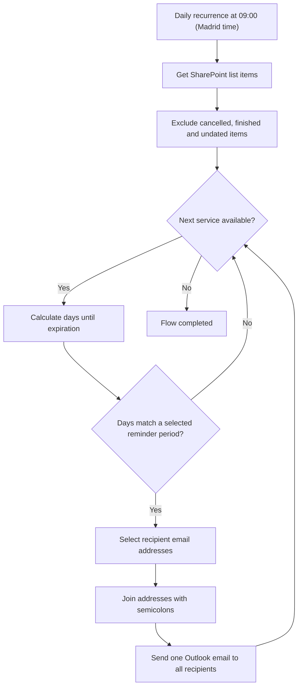

# Service Expiration Alerts | Power Automate

[Español](https://github.com/smartinmunoz/power-platform-portfolio-es/tree/main/Power-Automate/Service-Expiration-Alerts)

## Overview
Scheduled Power Automate cloud flow that checks upcoming service expiration dates in a SharePoint list and emails the people assigned to each service only when the remaining days match one of the selected reminder periods.

## Prerequisites
- SharePoint / Microsoft Lists list
- Power Automate with SharePoint connection
- Office 365 Outlook connection for notifications

## Minimum SharePoint list schema

| Display name (example) | Internal name | SharePoint column type | Requirements |
|---|---|---|---|
| Service | `Title` | Single line of text | Identifies the service; used in the email template |
| Expiration date | `Fechadevencimiento` | Date and Time (date-only recommended) | Must contain a date for processed items |
| Reminder periods | `Periododeaviso` | Choice, allow multiple selections | Numeric text options such as `90`, `30`, `15` |
| Notify | `Comunicara` | Person or Group, allow multiple selections | Required; users must have an email address |
| Status | `Estado` | Choice (single selection) or text | Values `90-Cancelado` and `40-Finalizado` are excluded |

**Note:** The internal names above reflect the implementation. A newly created SharePoint list must use matching internal names or the flow expressions must be updated. `Title` is the assumed service-name field; verify it in your list. Whether other fields are enforced as required by SharePoint depends on your list configuration.

## Flow outline
1. **Recurrence:** run daily, at 09:00 in the Madrid time zone.
2. **Get items:** filter out cancelled, finished, and undated items using OData:
   ```text
   Estado ne '90-Cancelado' and Estado ne '40-Finalizado' and Fechadevencimiento ne null
   ```
3. **Apply to each service:** calculate the whole calendar days between today's Madrid date and `Fechadevencimiento`.
4. **Reminder check:** determine whether the calculated number matches an exact value in the multi-select `Periododeaviso` column.
5. **Select emails:** extract each `Email` from the `Comunicara` person array.
6. **Join:** concatenate email strings with `;`.
7. **Send email (V2):** send one message per qualifying service, addressed to all configured recipients.

## Workflow diagram



The diagram reflects the published workflow's actions. It does not represent additional error handling, deduplication, or notification logging.

## Example
A service expiring in 30 days with reminder periods `90`, `30`, `15` sends a reminder today. A service with only `90` selected does not.

## Implementation notes
- SharePoint multi-choice fields may be returned as objects with `Value`; verify the actual **Get items** output before finalizing the exact-match condition.
- In **Select**, use text mode with the expression `item()?['Email']`, so **Join** receives an array of strings rather than objects.
- Do not add a second **Apply to each** for recipients when the intention is one email to all recipients.
- Ensure pagination is enabled if the list exceeds the default retrieval limit.
- Daily runs may resend notifications if the flow is run more than once on a matching date; this version does not include a sent-notification log.
- Test with an isolated record or filter by a test item ID before enabling production notifications.
- No tenant URL, personal email addresses, or organization-specific credentials are included.

## Status
**Tested and operational:** The original Power Automate flow has been successfully tested in its source environment. The anonymized JSON files below are reference workflow definitions, not complete importable Power Platform solutions.

- [English workflow definition](solution/Workflows/service-expiration-alerts.en.json)
- [Spanish workflow definition](https://github.com/smartinmunoz/power-platform-portfolio-es/blob/main/Power-Automate/Service-Expiration-Alerts/solution/Workflows/service-expiration-alerts.es.json)

To reuse either definition, configure the target SharePoint site and list, replace the placeholder list ID, configure the SharePoint and Office 365 Outlook connections, verify column names and status values, and test in the target environment. The published copies have not been independently validated after anonymization.

