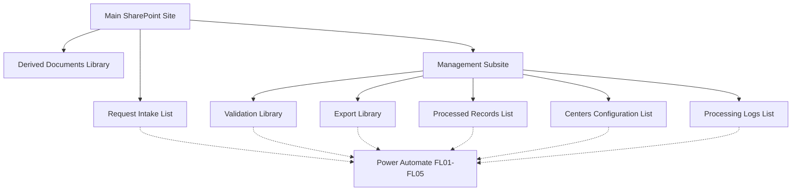

# SharePoint Online Architecture & Customizations

## Overview

This folder documents the SharePoint Online architecture, security configuration, document libraries, lists, and JSON customizations used in the SharePoint & Excel Automation Pipeline project.

The solution combines SharePoint Online, Microsoft Lists, Power Automate, and Office Scripts to manage request intake, document validation, Excel processing, record creation, and controlled access to information.

The architecture is presented as a reusable portfolio demonstration using fictional business scenarios.

No production URLs, credentials, real organizational identifiers, or confidential information are included.

## Technologies

- SharePoint Online
- Microsoft Lists
- SharePoint JSON Formatting
- Power Automate
- Office Scripts
- Microsoft Excel

## Solution Architecture

The solution uses two SharePoint locations:

1. **Main SharePoint Site:** Provides request submission and access to derived documents.
2. **Management Subsite:** Contains internal validation, processing, configuration, and logging resources.

The Management Subsite is a subsite of the Main SharePoint Site, not an independent site collection.

The architecture separates external-facing functionality from internal management operations.

### Architecture Diagram



The dotted connections represent integration with the broader Power Automate solution, not direct relationships between every resource and every workflow.

## Repository Structure

```text
Sharepoint/
├── README.md
├── architecture/
│   └── sites-architecture.md
├── sites/
│   ├── main-site.md
│   └── management-subsite.md
├── lists/
│   ├── request-intake.md
│   ├── processed-records.md
│   ├── centers-configuration.md
│   └── processing-logs.md
├── libraries/
│   ├── derived-documents.md
│   ├── validation-library.md
│   └── export-library.md
├── forms/
│   └── request-intake-form.json
└── formatting/
    ├── request-intake-view.json
    └── document-library-commandbar.json
```

## Architecture Documentation

| Document | Description |
|---|---|
| [Sites Architecture](architecture/sites-architecture.md) | SharePoint site hierarchy, resources, and security model |
| [Main Site](sites/main-site.md) | External-facing request intake and document consultation |
| [Management Subsite](sites/management-subsite.md) | Internal processing resources and access controls |

## SharePoint Lists

### Request Intake List

[View documentation](lists/request-intake.md)

Located in the Main SharePoint Site.

Allows authorized external staff to submit requests using a customized SharePoint form.

The user-facing fields include:

- Observations
- Excel file attachments

The list also contains standard SharePoint system fields.

### Processed Records List

[View documentation](lists/processed-records.md)

Located in the Management Subsite.

Stores primary and associated records generated from Excel processing.

The solution uses:

- Primary records identified as T.
- Associated records identified as B.
- ParentRecordId relationships.
- Center-based item permissions managed by FL05.

### Centers Configuration List

[View documentation](lists/centers-configuration.md)

Stores center configuration and SharePoint group references.

The list includes:

- Center
- SharePoint Group ID
- Group Management Link

FL05 uses the configured group identifiers when assigning record-level permissions.

### Processing Logs List

[View documentation](lists/processing-logs.md)

Stores processing execution information generated through FL04.

The logging architecture supports:

- Execution traceability.
- Processing results.
- Error tracking.
- Record creation summaries.
- Diagnostic information.

The list is not accessible to external staff or Center Groups.

## Document Libraries

### Derived Documents Library

[View documentation](libraries/derived-documents.md)

Located in the Main SharePoint Site.

Provides read-only access to derived documents for authorized users, including external staff where applicable.

### Validation Library

[View documentation](libraries/validation-library.md)

Located in the Management Subsite.

Stores Excel documents awaiting validation and processing.

FL02 protects validated documents by breaking file-level permission inheritance, assigning read-only permissions to Owners and Members, and updating the status to Tractat.

### Export Library

[View documentation](libraries/export-library.md)

Located in the Management Subsite.

Stores Excel workbooks generated by the processing workflow.

Owners, Members, and Center Groups have read-only access.

An authorized Power Automate connection performs the necessary file creation and update operations.

## JSON Customizations

SharePoint JSON formatting is used to customize supported interface elements.

These customizations improve usability but do not replace SharePoint permissions.

### Request Intake View

[View JSON](formatting/request-intake-view.json)

Customizes the Request Intake List command bar.

Features include:

- Renaming New to New Request.
- Hiding grid editing.
- Hiding sharing and copy-link commands.
- Hiding export options.
- Hiding non-essential automation and integration commands.

### Document Library Command Bar

[View JSON](formatting/document-library-commandbar.json)

Provides a simplified command bar for selected document libraries.

Depending on the supported interface, it can:

- Highlight grid editing.
- Hide upload and creation commands.
- Hide delete, rename, move, and copy commands.
- Hide sharing and export options.
- Reduce unnecessary interface actions.

The same formatting can be adapted to libraries with different permission models.

The JSON must be tested against the intended SharePoint interface.

### Request Intake Form

[View JSON](forms/request-intake-form.json)

Contains a conceptual layout configuration for the Request Intake List form.

The layout references:

- Observations
- Attachments

The standard SharePoint attachment control must be enabled and validated separately.

The JSON does not create columns, enable attachments, or provision the list.

## Security Model

The solution uses several layers of SharePoint security.

### Site-Level Security

The Main SharePoint Site provides access to authorized external staff and management users.

The Management Subsite restricts access to internal resources according to user roles.

### Library-Level Security

Individual libraries use access rules appropriate to their purpose.

Examples include:

- Read-only access to derived documents.
- Restricted access to validation documents.
- Read-only access to generated export files.

### Item-Level Security

FL05 assigns permissions to processed records according to their associated center.

Each Center Group can access only the records authorized for that center.

### Processed Document Protection

FL02 applies file-level permission changes to validated documents.

Site Collection Administrators retain administrative control.

### Important Security Principle

**SharePoint JSON formatting is not a security boundary.**

Hiding a button does not prevent an operation if the user still has permission to perform it through another interface.

Actual security must be implemented through SharePoint permissions and appropriate configuration.


## Power Automate Integration

The SharePoint architecture integrates with five conceptual Power Automate workflows.

| Workflow | Responsibility |
|---|---|
| FL01 | Retrieves Excel attachments from the Request Intake List, creates document copies in the Derived Documents Library and Validation Library, and applies request item-level permissions. |
| FL02 | Processes validated Excel files, protects source documents, creates primary and associated records, and generates export workbooks. |
| FL03 | Removes temporary processing files older than eight hours. |
| FL04 | Creates processing log entries and returns the `Id_Log` identifier to FL02. |
| FL05 | Applies center-based item-level permissions to processed records using the Centers Configuration List. |

### Workflow Coordination

FL01 handles document intake and distribution between the Main SharePoint Site and the Management Subsite.

FL02 handles the validated document processing lifecycle.

FL04 provides execution logging, while FL05 manages center-specific record permissions.

FL03 performs temporary file cleanup independently according to its configured schedule.

The workflows are documented in the parent project's `flows/` and `docs/` directories.


## Implementation Considerations

The architecture is intended to be adapted to different environments.

Implementation activities may include:

1. Creating the required SharePoint sites and resources.
2. Configuring list columns and document libraries.
3. Assigning site, library, and item permissions.
4. Enabling attachments on the Request Intake List.
5. Applying supported JSON customizations.
6. Configuring Power Automate connections.
7. Adapting Excel templates and Office Scripts.
8. Testing the workflows with fictional data.
9. Validating effective permissions for each user role.

The documentation does not automatically provision the SharePoint environment.

## Reusability

The solution demonstrates reusable patterns for:

- Request management.
- Document validation.
- Excel automation.
- SharePoint record relationships.
- Role-based and item-level access.
- Execution logging.
- Interface customization.
- Separation of external-facing and internal resources.

The examples are intended for learning, demonstration, and portfolio purposes.


## Documentation Status

**Status: SharePoint architecture and resource documentation complete.**

The following components are documented:

- Main SharePoint Site and Management Subsite.
- SharePoint site hierarchy and security architecture.
- Four SharePoint lists and their functional responsibilities.
- Three document libraries and their access models.
- Request Intake List form layout example.
- Two SharePoint JSON command bar customization examples.
- Document validation and protection lifecycle.
- Primary and associated record relationships.
- Center-based item-level permission management.
- Processing logs and execution traceability.
- Integration with Power Automate workflows FL01 through FL05.

### Implementation Validation

The following activities require validation in a target SharePoint environment:

- Site and subsite configuration.
- List and library provisioning.
- SharePoint group membership and effective permissions.
- Resource-level and item-level permission inheritance.
- Request form attachment behavior.
- JSON formatting compatibility.
- Power Automate connections and execution permissions.
- Excel processing and Office Scripts integration.
- End-to-end workflow and security testing.

### Portfolio Scope

This repository provides conceptual architecture documentation and selected reusable configuration examples.

It does not contain a fully deployable SharePoint provisioning package.

All examples use fictionalized scenarios and exclude production credentials, real organizational identifiers, and confidential business information.
