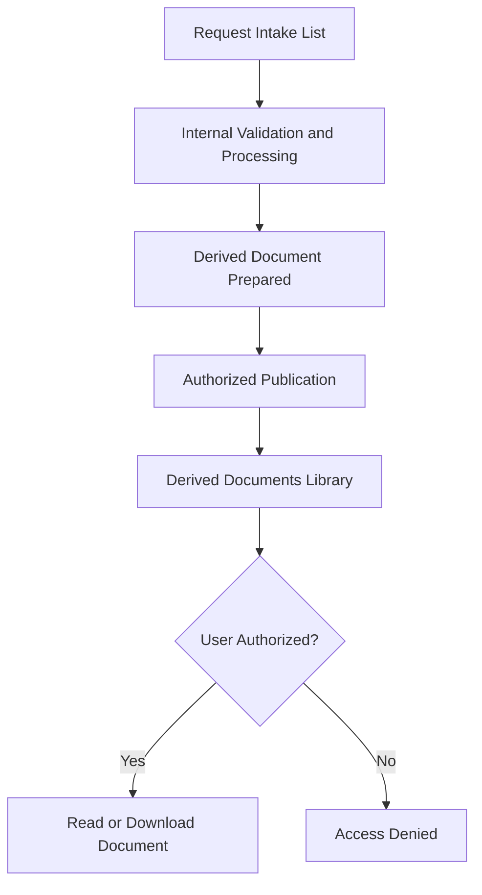

# Derived Documents Library

## 1. Overview

The Derived Documents Library is a SharePoint Online document library located in the Main SharePoint Site.

It provides centralized access to documents generated or made available as part of the automated request processing solution.

The library is designed to allow authorized users, including external staff where applicable, to consult and download documents without modifying them.

> **Portfolio disclaimer:** This documentation describes a conceptual demonstration using fictional names and examples. No production URLs, credentials, real identifiers, or confidential business information are included.

## 2. Library Configuration

| Property | Configuration |
|---|---|
| Library Name | Derived Documents Library |
| Location | Main SharePoint Site |
| Library Type | SharePoint Document Library |
| Primary Purpose | Access to derived documents |
| User Access | Read-only |
| External Staff | Read access when authorized |
| Document Modification | Restricted to authorized processes or administrators |

The exact document formats and metadata fields depend on the implementation.

## 3. Purpose

The library provides a controlled location for documents that users need to consult after the request or processing lifecycle.

Its main objectives are:

- Centralize access to derived documents.
- Provide a consistent document consultation experience.
- Separate derived documents from original request attachments.
- Allow authorized users to download documents.
- Prevent unauthorized modification.
- Support traceability and document management.

The library complements the Request Intake List in the Main SharePoint Site.

## 4. Main Site Integration

The Main SharePoint Site provides the user-facing entry point for the solution.

Its principal resources include:

- **Request Intake List:** Allows external staff to submit requests using a customized SharePoint form.
- **Derived Documents Library:** Provides read-only access to documents made available to authorized users.

The Management Subsite contains the internal validation, processing, configuration, and logging resources.

This separation helps distinguish external-facing functionality from internal management operations.

## 5. Document Lifecycle

The document lifecycle begins when an authorized user submits a new item in the Request Intake List with an attached Excel workbook.

FL01 performs the initial document distribution:

1. An authorized user creates a request and attaches an Excel workbook.
2. FL01 retrieves the Excel attachment from the Request Intake List.
3. FL01 creates a document copy in the Derived Documents Library, located in the Main SharePoint Site.
4. FL01 creates a separate copy in the Validation Library, located in the Management Subsite.
5. The Derived Documents Library provides read-only access to authorized Main Site users, including external staff, Site Members, and Site Owners.
6. The Validation Library follows its own restricted permission model for internal validation and subsequent processing.

The Derived Documents Library does not depend on FL02 or a separate publication workflow to receive the initial document copy.

The two document copies serve different purposes and follow independent access-control requirements.

## 6. Permissions

The library uses a read-only access model for ordinary users.

| Role | Access |
|---|---|
| Site Collection Administrators | Administrative control |
| Site Owners | According to authorized role |
| Site Members | According to authorized role |
| Authorized External Staff | Read |
| Unauthorized Users | No access |
| Authorized Automation Connection | Permissions required for document publication |

Read access allows users to open and download documents without granting editing rights.

The effective permission configuration must be validated in the target environment.

## 7. Security Architecture

The Derived Documents Library is located in the Main SharePoint Site because it supports authorized document consultation.

It must not expose internal resources from the Management Subsite.

Security requirements include:

- Restricting document modification.
- Granting access only to authorized users.
- Preventing access to internal processing logs.
- Avoiding exposure of validation documents.
- Applying least-privilege permissions.
- Reviewing access when documents contain sensitive information.

If different users must access different documents, additional document-level permissions may be required.

This is an implementation decision and is not assumed to be part of the current demonstration.

## 8. Document Access Workflow

This diagram represents the conceptual document availability process.

It does not specify a separate publication flow or an automatic synchronization mechanism.

## 9. Document Organization

The library can use SharePoint metadata and views to improve document navigation.

Possible configuration options include:

- Document type.
- Creation date.
- Request reference.
- Processing reference.
- Document status.
- Custom views.
- File naming conventions.

These are optional configuration examples.

The exact metadata structure must be defined according to the implementation requirements.

## 10. User Experience

The library should provide a simple and consistent consultation experience.

Recommended design considerations include:

- Clear document names.
- Useful metadata columns.
- Simplified library views.
- Appropriate filtering and sorting.
- Read-only access for ordinary users.
- Consistent navigation from the Main SharePoint Site.

SharePoint JSON formatting may be used to customize the interface.

However, interface customization does not replace SharePoint permission management.

## 11. Integration with Power Automate

The broader solution uses several Power Automate workflows.

### FL01 - Request Intake

Supports the request intake and validation lifecycle.

### FL02 - Excel Processing

Processes validated Excel workbooks, creates SharePoint records, and generates export workbooks.

### Document Publication

A publication process may be used to make derived documents available in the Main SharePoint Site.

The exact mechanism is implementation-specific and is not defined as an additional workflow in this portfolio.

### FL04 - Processing Logs

Records processing execution information in the Management Subsite.

### FL05 - Record Permissions

Applies center-based permissions to processed records in the Management Subsite.

The Derived Documents Library has its own access requirements and should not automatically inherit the record-level permission model of FL05.

## 12. Security and Governance Considerations

- Use SharePoint permissions to enforce access.
- Validate effective permissions before publication.
- Restrict modification to authorized identities.
- Avoid sharing confidential documents through unrestricted links.
- Review document retention requirements.
- Consider version history where appropriate.
- Audit document access according to organizational requirements.
- Do not publish production URLs or sensitive configuration details in public repositories.

## 13. Related Documentation

- [Main SharePoint Site](../sites/main-site.md)
- [Request Intake List](../lists/request-intake.md)
- [Management Subsite](../sites/management-subsite.md)
- [Validation Library](validation-library.md)
- [Export Library](export-library.md)
- [SharePoint Sites Architecture](../architecture/sites-architecture.md)
- [SharePoint Overview](../README.md)

## 14. Documentation Status

**Status:** Conceptual library documentation complete.

The following implementation details remain configurable:

- Exact document publication mechanism.
- Library metadata columns.
- Document naming conventions.
- User and group permissions.
- Document retention policies.
- Library views and interface formatting.

This document is not an automated SharePoint library provisioning template.
