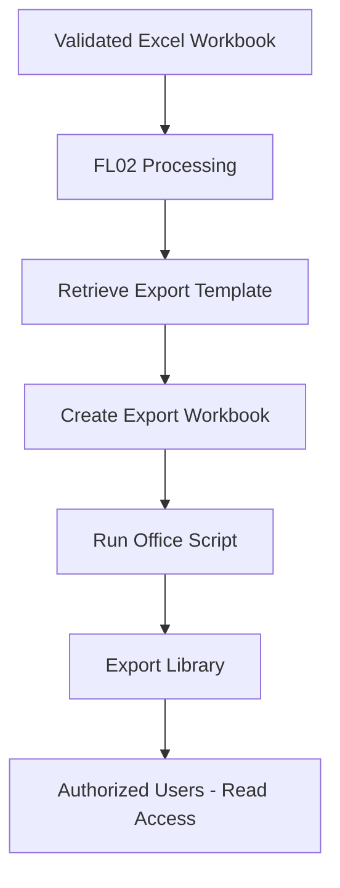

# Export Library

## 1. Overview

The Export Library is a SharePoint Online document library located in the Management Subsite.

It provides centralized storage for Excel workbooks generated by the automated processing solution.

The library separates generated output documents from the original files stored in the Validation Library.

> **Portfolio disclaimer:** This documentation describes a conceptual demonstration. All names and examples are fictional. No production URLs, credentials, real identifiers, or confidential business information are included.

## 2. Library Configuration

| Property | Configuration |
|---|---|
| Library Name | Export Library |
| Location | Management Subsite |
| Library Type | SharePoint Document Library |
| Document Format | Excel workbooks |
| File Generation | Power Automate FL02 |
| User Access | Read-only |
| Command Bar | Customizable through SharePoint JSON formatting |

## 3. Purpose

The Export Library stores structured Excel documents generated during the processing lifecycle.

Its main objectives are:

- Centralize generated Excel workbooks.
- Provide a consistent location for processed outputs.
- Allow authorized users to consult and download files.
- Separate original source documents from generated documents.
- Support document traceability.

The library structure can be adapted to different business requirements.

## 4. Export Generation Process

FL02 generates an Excel export workbook as part of the validated document processing workflow.

The export generation process uses an Excel template and Office Scripts to transform the validated source information into a structured output workbook.

The conceptual sequence is:

1. FL02 detects a validated Excel document in the Validation Library.
2. FL02 retrieves the source workbook and creates a temporary processing copy.
3. An Office Script extracts and structures the source workbook data.
4. FL02 retrieves the predefined Excel export template.
5. FL02 creates a new workbook in the Export Library using the template.
6. A second Office Script populates the generated workbook with the extracted data.
7. The completed export workbook remains available in the Export Library.
8. Authorized Site Owners, Site Members, and Center Groups can consult and download the generated document with read-only permissions.

The export generation process is part of FL02 and does not require a separate Power Automate workflow.

The complete FL02 workflow also includes SharePoint record creation, error handling, execution logging through FL04, and temporary file cleanup through FL03.

## 5. Integration with Office Scripts

The solution uses Office Scripts to process Excel information.

A demonstration implementation includes scripts for:

- Extracting and structuring source workbook data.
- Populating an export template.
- Preparing the generated workbook for subsequent use.

The Office Scripts are documented separately in the project.

The Excel template and column mappings can be adapted to the requirements of each implementation.

## 6. Permissions

The Export Library provides read-only access to authorized management users and center groups.

| Role | Permission |
|---|---|
| Site Collection Administrators | Administrative control |
| Site Owners | Read |
| Site Members | Read |
| Center Groups | Read |
| External Staff | No access |

The permissions allow authorized users to view and download generated files without granting ordinary editing capabilities.

FL02 uses an appropriately authorized Power Automate connection to create and populate export workbooks.

The automation connection must have sufficient permissions to perform its operations.

## 7. Document Library Customization

The solution includes SharePoint JSON command bar formatting.

The existing demonstration file is available at:

[Document Library Command Bar JSON](../formatting/document-library-commandbar.json)

Command bar formatting can be used to:

- Customize visible commands.
- Rename actions.
- Simplify the user interface.
- Highlight relevant library operations.

The demonstration JSON must be reviewed and adapted to the intended library experience.

**Important:** JSON formatting does not enforce SharePoint permissions.

For example, hiding an editing command does not remove a user's underlying permission to edit documents.

## 8. Export Workflow Diagram

This diagram represents the conceptual export generation process.

The complete workflow also includes record creation, error handling, and execution logging.

## 9. Document Organization

Generated documents can be organized according to operational requirements.

Possible strategies include:

- File naming conventions.
- Creation date.
- Source document references.
- Processing execution identifiers.
- Additional metadata columns.
- SharePoint views.

These are optional design choices rather than mandatory configuration elements.

The exact organization should be adapted to the implementation.

## 10. Security Considerations

- Apply least-privilege access.
- Restrict ordinary users to read-only permissions.
- Use an authorized automation connection for file creation.
- Verify effective permissions for users belonging to multiple groups.
- Avoid exposing generated files to unauthorized external users.
- Do not rely on JSON formatting as a security mechanism.
- Review access when generated workbooks contain sensitive information.
- Validate permissions in a controlled test environment.

## 11. Related Documentation

- [Management Subsite](../sites/management-subsite.md)
- [Validation Library](validation-library.md)
- [SharePoint Sites Architecture](../architecture/sites-architecture.md)
- [Document Library Command Bar JSON](../formatting/document-library-commandbar.json)
- [SharePoint Overview](../README.md)

## 12. Documentation Status

**Status:** Conceptual library documentation complete.

The following implementation details remain configurable:

- Export template structure.
- Document naming conventions.
- Additional metadata columns.
- Automation connection permissions.
- Library-specific command bar formatting.

This document is not an automated SharePoint library provisioning template.
