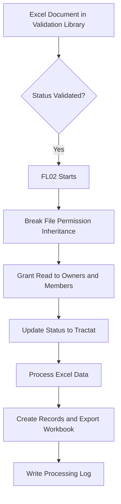

# Validation Library

## 1. Overview

The Validation Library is a SharePoint Online document library located in the Management Subsite.

It stores Excel workbooks awaiting validation and processing through Power Automate.

The library implements document-level security to protect validated files against unauthorized modification.

> **Portfolio disclaimer:** This documentation describes a conceptual demonstration using fictional names. No production URLs, credentials, real identifiers, or confidential information are included.

## 2. Library Configuration

| Property | Configuration |
|---|---|
| Library Name | Validation Library |
| Location | Management Subsite |
| Library Type | SharePoint Document Library |
| Document Format | Excel workbooks |
| Processing Workflow | FL02 |
| Security Model | Library-level and file-level permissions |
| External Staff Access | Not permitted |
| Center Groups Access | Not permitted |

## 3. Document Lifecycle

Documents enter the Validation Library through FL01, which starts when a new request is submitted in the Main SharePoint Site.

The document lifecycle is:

1. An authorized user submits a request with an attached Excel workbook through the Request Intake List.
2. FL01 retrieves the Excel attachment.
3. FL01 creates a copy in the Derived Documents Library in the Main SharePoint Site.
4. FL01 creates a separate copy in the Validation Library in the Management Subsite.
5. Authorized Site Owners and Site Members review and validate the document.
6. The document status changes to `Validated`, triggering FL02.
7. FL02 breaks file-level permission inheritance and grants Read access to Site Owners and Site Members.
8. FL02 updates the document status to `Tractat` before continuing with Excel processing.
9. FL02 processes the Excel data, creates SharePoint records, generates the export workbook, and records processing results through FL04.

The Validation Library is restricted to authorized management users. External Staff and Center Groups cannot access its documents.

The `Tractat` status indicates that the document has entered the protected processing stage, not necessarily that every downstream operation completed successfully.

## 4. Document Status

The processing workflow uses document metadata to identify files ready for processing.

The demonstration uses the following conceptual statuses:

| Status | Purpose |
|---|---|
| Pending Validation | Document awaiting review |
| Validated | Document approved for processing |
| Tractat (Processed) | Document marked as processed and protected |

The exact SharePoint choice values and internal column names must match the target implementation.

The `Validated` status is used by the FL02 trigger condition.

## 5. Library Permissions

The Validation Library uses unique permissions rather than unrestricted inheritance from the Management Subsite.

| Role | Access |
|---|---|
| Site Collection Administrators | Administrative control |
| Site Owners | Authorized management access |
| Site Members | Authorized management access |
| Center Groups | No access |
| External Staff | No access |

Center Groups are excluded even though they have general read access to the Management Subsite.

## 6. Processed Document Protection

FL02 modifies file-level permissions when a document is validated and transitions to `Tractat`.

The workflow performs the following operations:

1. Breaks permission inheritance on the file.
2. Grants Read permission to the Site Owners group.
3. Grants Read permission to the Site Members group.
4. Updates the document status to `Tractat`.
5. Continues the main Excel processing operations.

Under this security model, ordinary Site Owners and Members cannot modify the protected document.

Site Collection Administrators retain administrative privileges.

The effective permissions must be validated to ensure that no additional group memberships or direct grants provide unintended editing access.

## 7. Processing Workflow

This diagram summarizes the conceptual processing sequence.

The complete workflow, including error handling and record relationships, is documented separately in FL02.

## 8. Important Processing Consideration

The document is marked as `Tractat` before all downstream processing operations necessarily finish.

Therefore, this status indicates that the document has entered the protected processing stage.

It does not independently guarantee that all Excel records were successfully created.

The Processing Logs List provides additional execution and error information through FL04.

## 9. Integration with Power Automate

### FL01 - Document Intake

Supports the initial request and validation lifecycle.

### FL02 - Excel Processing

Handles:

- Validated document detection.
- File-level permission changes.
- Status updates.
- Excel extraction.
- Creation of primary and associated records.
- Export workbook generation.
- Processing summaries and logging.

### FL04 - Processing Logs

Stores processing results and diagnostic information in the Processing Logs List.

### FL05 - Record Permissions

Applies center-based permissions to processed SharePoint records.

## 10. Security Considerations

- Break inheritance only where required.
- Exclude unauthorized Center Groups.
- Restrict modification of processed documents.
- Preserve administrative access for Site Collection Administrators.
- Validate effective permissions after permission changes.
- Use an appropriately authorized Power Automate connection.
- Do not rely on JSON formatting to enforce security.
- Avoid exposing production identifiers in public repositories.

## 11. Related Documentation

- [Management Subsite](../sites/management-subsite.md)
- [SharePoint Sites Architecture](../architecture/sites-architecture.md)
- [Processed Records List](../lists/processed-records.md)
- [Processing Logs List](../lists/processing-logs.md)
- [SharePoint Overview](../README.md)

## 12. Documentation Status

**Status:** Conceptual library documentation complete.

The following implementation details are environment-specific:

- Exact metadata column names.
- SharePoint permission role definitions.
- Power Automate connection references.
- Production library identifiers.

This document is not an automated SharePoint library provisioning template.
