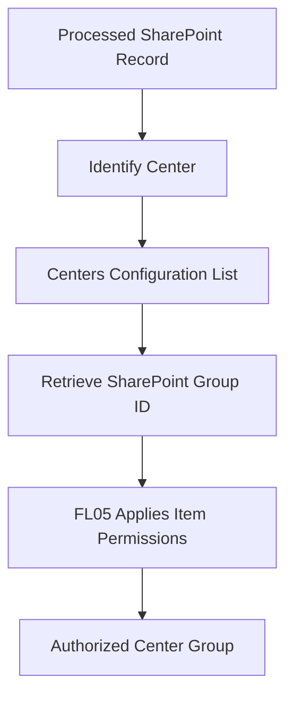

# Centers Configuration List

## 1. Overview

The Centers Configuration List is a SharePoint Online list located in the Management Subsite.

It provides a centralized configuration for mapping operational centers to SharePoint security groups.

The list supports automated item-level permission management through Power Automate FL05.

It also provides links that allow authorized administrators to manage SharePoint group membership.

> **Portfolio disclaimer:** All center names, group identifiers, and URLs used in this documentation are fictional. No production information or confidential data is included.

## 2. List Configuration

| Property | Configuration |
|---|---|
| List Name | Centers Configuration |
| Location | Management Subsite |
| List Type | SharePoint Online List |
| Purpose | Center-to-group mapping |
| Access | Read for all authorized subsite users |
| Automation Integration | Power Automate FL05 |
| Group Administration | SharePoint group management links |

The solution uses a single configuration list rather than separate lists for center mapping and group administration.

## 3. List Columns

The configuration list contains three main fields.

| Column | Suggested Type | Description |
|---|---|---|
| Center | Single line of text | Name or identifier of the operational center |
| SharePoint Group ID | Number | SharePoint group identifier associated with the center |
| Group Management Link | Hyperlink | Link to the corresponding SharePoint group management page |

The SharePoint internal field names may differ from the display names.

Additional columns can be introduced if required by the organization.

## 4. Example Configuration

The following data is fictional.

| Center | SharePoint Group ID | Group Management Link |
|---|---|---|
| Center North | 101 | Example group management URL |
| Center South | 102 | Example group management URL |
| Center East | 103 | Example group management URL |

The numerical values are demonstration identifiers only.

Real SharePoint group IDs and administrative URLs must be configured in the target environment.

## 5. SharePoint Group Management

Each center is associated with a SharePoint security group.

The Group Management Link provides a convenient entry point to the corresponding SharePoint group administration interface.

Authorized group administrators can use this link to manage membership.

Users with read-only access can view the link but cannot manage group membership unless they also have the required SharePoint permissions.

Group administration is controlled by SharePoint security, not by visibility of the hyperlink.

## 6. Permissions

The Centers Configuration List is readable by all users who have access to the Management Subsite.

| Role | Permission |
|---|---|
| Site Collection Administrators | Administrative control |
| Site Owners | Read |
| Site Members | Read |
| Center Groups | Read |
| External Staff | No access |

The documented Read permissions describe ordinary access to the list.

Administrative privileges and any authorized configuration maintenance permissions must be managed separately.

## 7. Integration with FL05

The Centers Configuration List provides the mapping between operational centers and their corresponding SharePoint security groups.

FL05 uses this configuration to dynamically assign item-level permissions to records stored in the Processed Records List.

### Configuration Lookup Process

1. FL05 receives the information required to identify the processed SharePoint record and its associated operational center.
2. FL05 searches the Centers Configuration List for the corresponding center.
3. The workflow retrieves the SharePoint Group ID stored in the matching configuration item.
4. FL05 uses the retrieved group identifier to assign permissions to the processed SharePoint record.
5. The assigned center group receives Read access to the corresponding record.
6. Other center groups must not receive access to records outside their assigned center.

### Configuration Responsibilities

| Component | Responsibility |
|---|---|
| Centers Configuration List | Stores center-to-group mappings |
| SharePoint Group ID | Identifies the security group associated with a center |
| Group Management Link | Provides access to SharePoint group administration |
| FL05 | Applies dynamic item-level permissions |
| Processed Records List | Stores the records protected by center-based permissions |

### Important Considerations

The Centers Configuration List is the central reference for resolving center-specific SharePoint groups.

FL05 must validate that a matching center configuration exists before attempting permission assignment.

Missing, duplicated, or invalid group mappings should be treated as configuration errors and must not result in unintended access.

The Group Management Link is intended for administrative convenience and is not required for the automated permission assignment process.

SharePoint group membership and effective access remain controlled by SharePoint security.

## 8. Permission Assignment Diagram

The diagram represents the conceptual permission assignment process.

The exact SharePoint actions and permission levels are documented in the FL05 workflow documentation.

## 9. Configuration Maintenance

When a new operational center is introduced, an authorized administrator can:

1. Create or identify the corresponding SharePoint group.
2. Add the center to the configuration list.
3. Enter the SharePoint Group ID.
4. Add the group management link.
5. Validate the mapping.
6. Test permission assignment through FL05.

When a center changes its associated group, the configuration should be reviewed to ensure that future permission assignments use the correct group.

Changes to the configuration do not automatically update permissions already assigned to existing records unless an additional workflow or reassignment process is implemented.

## 10. Security Considerations

- Apply the principle of least privilege.
- Restrict modification of center configuration to authorized administrators.
- Validate SharePoint Group IDs before using them.
- Avoid exposing production group management URLs in public repositories.
- Review membership of center groups periodically.
- Verify effective permissions after FL05 runs.
- Ensure that users cannot gain administrative rights merely by accessing group management links.
- Consider users who belong to multiple center groups.

## 11. Related Documentation

- [Management Subsite](../sites/management-subsite.md)
- [Processed Records List](processed-records.md)
- [SharePoint Sites Architecture](../architecture/sites-architecture.md)
- [SharePoint Overview](../README.md)

## 12. Documentation Status

**Status:** Conceptual configuration list documentation complete.

The list structure can be extended according to organizational requirements.

Real SharePoint group identifiers and administration URLs must be supplied during implementation.

This document is not an automated SharePoint provisioning template.
