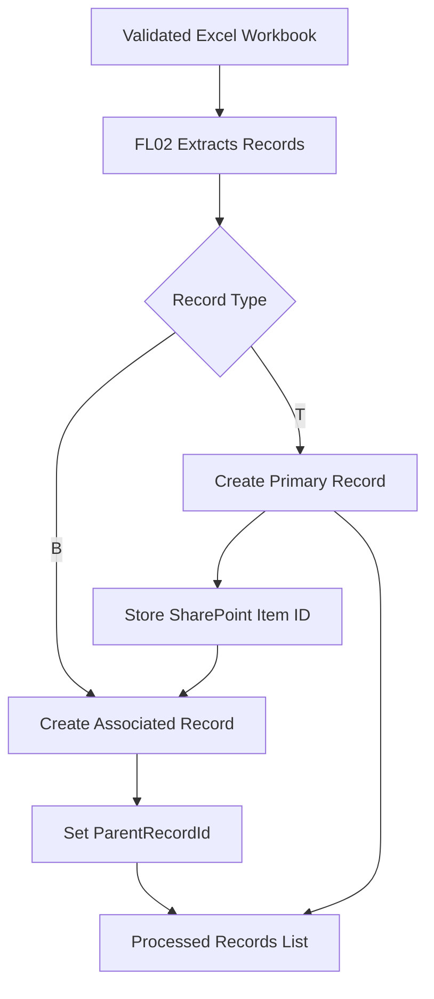

# Processed Records List

## 1. Overview

The Processed Records List is a SharePoint Online list located in the Management Subsite.

It stores structured information extracted from validated Excel workbooks through Power Automate.

The solution supports primary and associated records, relationships between records, and center-based access control.

The list is designed to be adaptable to different business requirements and Excel data structures.

> **Portfolio disclaimer:** This documentation describes a conceptual demonstration using fictional information. It does not contain production data, real group identifiers, or confidential business information.

## 2. List Configuration

| Property | Configuration |
|---|---|
| List Name | Processed Records |
| Location | Management Subsite |
| List Type | SharePoint Online List |
| Data Source | Validated Excel workbooks |
| Record Creation | Power Automate FL02 |
| Permission Management | Power Automate FL05 |
| Data Structure | Configurable according to business requirements |

## 3. Flexible Column Structure

The SharePoint list is designed to accommodate information extracted from Excel workbooks.

Additional columns can be created depending on the data being processed and the needs of each organization.

For example, an implementation may include:

- Record identifiers.
- Names or descriptions.
- Dates.
- Numeric values.
- Categories.
- Status information.
- Additional business-specific attributes.

These are examples rather than mandatory fields.

When new fields are required, the solution can be extended by:

1. Adding the corresponding columns to the SharePoint list.
2. Updating the Excel extraction logic where necessary.
3. Updating the field mapping in FL02.
4. Testing the processing workflow with the revised structure.

This approach allows the solution to be reused in different scenarios without requiring a fixed business-specific schema.

## 4. Record Types

The processing workflow supports two record types.

### 4.1 Primary Records (T)

Primary records represent the main entities extracted from the Excel workbook.

When FL02 creates a primary record, it stores the generated SharePoint item ID.

This identifier can then be used to establish relationships with associated records.

### 4.2 Associated Records (B)

Associated records contain information linked to a primary record.

They reference the corresponding primary SharePoint item through the `ParentRecordId` field.

This allows related information to be stored as separate list items while preserving the relationship between records.

## 5. Record Relationships

The relationship between primary and associated records is established during processing.



The demonstration assumes that records are processed in an order that allows the relevant primary record to be identified before creating its associated records.

FL02 processes records sequentially to maintain this relationship.

## 6. Family Identification

The solution can use a composite family identifier to distinguish groups of related records.

A demonstration expression is:

```text
concat(SourceFileId, '-', FamilyId)
```

This combines the source document identifier with the family identifier.

The composite value helps distinguish records originating from different Excel files.

The exact field names and identifier strategy can be adapted to the implementation.

## 7. Center-Based Classification

Each processed record is associated with an operational center.

The center information is used to determine which SharePoint group should receive access to the record.

The relationship between centers and SharePoint groups is maintained in the Centers Configuration List.

This separates business data from access control configuration.

## 8. Item-Level Permissions

FL05 applies permissions to individual SharePoint list items according to their associated center.

The permission workflow:

1. Identifies the center associated with the processed record.
2. Retrieves the corresponding SharePoint group ID from the Centers Configuration List.
3. Applies the required item-level permissions.
4. Restricts access so center groups can view only records assigned to them.

Site Collection Administrators retain administrative access.

Site Owners and Members retain access according to the configured security model.

General read access to the Management Subsite does not automatically grant access to every processed record.

## 9. Integration with Power Automate

### FL02 - Excel Processing

FL02 is responsible for:

- Reading validated Excel data.
- Identifying primary and associated records.
- Creating SharePoint list items.
- Maintaining record relationships.
- Recording processing results and errors.

### FL05 - Permission Management

FL05 is responsible for:

- Identifying the record's center.
- Resolving the associated SharePoint group.
- Applying item-level permissions.

### FL04 - Processing Logs

FL04 provides execution traceability by recording processing results and diagnostic information.

## 10. Example Data

The following example is fictional and illustrates the relationship between records.

| Item ID | Record Type | Description | ParentRecordId | Center |
|---|---|---|---|---|
| 101 | T | Primary Record A | | Center North |
| 102 | B | Associated Record A1 | 101 | Center North |
| 103 | B | Associated Record A2 | 101 | Center North |
| 104 | T | Primary Record B | | Center South |
| 105 | B | Associated Record B1 | 104 | Center South |

The example does not define a mandatory SharePoint schema.

Additional fields can be added to support different Excel templates and processing requirements.

## 11. Security Considerations

- Apply least-privilege permissions.
- Restrict access through SharePoint item-level permissions.
- Use the Centers Configuration List to resolve group assignments.
- Avoid exposing records from unrelated centers.
- Review effective permissions for users belonging to multiple groups.
- Validate permission inheritance and access assignments.
- Do not store real group IDs or confidential information in public examples.

## 12. Related Documentation

- [Management Subsite](../sites/management-subsite.md)
- [SharePoint Sites Architecture](../architecture/sites-architecture.md)
- [SharePoint Overview](../README.md)

## 13. Documentation Status

**Status:** Conceptual list documentation complete.

The SharePoint column schema can be extended according to the Excel source structure and business requirements.

Detailed provisioning scripts and production-specific field mappings are intentionally excluded from this portfolio example.

This document is not an automated SharePoint list provisioning template.
