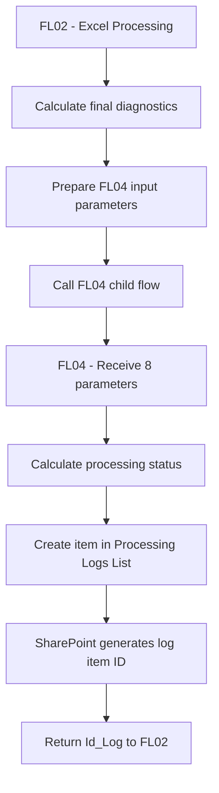

# Processing Logs List

## 1. Overview

The Processing Logs List is a SharePoint Online list located in the Management Subsite.

It provides centralized logging and traceability for automated document processing operations.

The list is populated by Power Automate FL04, which records execution information received from the processing workflow.

It supports operational monitoring, troubleshooting, and historical analysis.

> **Portfolio disclaimer:** This documentation describes a conceptual demonstration using fictional information. No production URLs, credentials, real identifiers, or confidential business data are included.

## 2. List Configuration

| Property | Configuration |
|---|---|
| List Name | Processing Logs |
| Location | Management Subsite |
| List Type | SharePoint Online List |
| Purpose | Execution logging and traceability |
| Record Creation | Power Automate FL04 |
| User Access | Read-only for Site Owners and Site Members |
| Center Groups | No access |
| Schema | Adaptable to implementation requirements |

## 3. Log Information

The Processing Logs List stores information about individual Excel processing executions.

The following conceptual schema is aligned with the fields defined in `FL04-demo.json`.

### SharePoint Column Schema

| Display Name | Internal Name | Type | Description |
|---|---|---|---|
| Processing Reference ID | ProcessingReferenceId | Number | Reference identifier for the processing operation |
| Source File ID | SourceFileId | Number | Identifier of the source SharePoint file |
| Execution ID | ExecutionId | Single line of text | Power Automate execution identifier |
| Execution Date | ExecutionDate | Date and time | UTC timestamp generated by FL04 |
| Records Read | RecordsRead | Number | Total records extracted from Excel |
| Records Created | RecordsCreated | Number | Successfully created SharePoint records |
| Records With Errors | RecordsWithErrors | Number | Failed SharePoint record creation operations |
| Processing Status | Status | Choice | Calculated execution status |
| Error Details | ErrorDetails | Multiple lines of text | Consolidated SharePoint creation error details |

### Processing Status Values

The `Status` column uses the following conceptual choice values:

| Value | Meaning |
|---|---|
| Success | Records created without reported SharePoint creation errors |
| Partial Success | Records created with one or more SharePoint creation errors |
| Error | No records created and at least one SharePoint creation error |
| No Records | No records created and no SharePoint creation errors reported |

These values match the status logic defined in FL04.

### Error Counting Scope

`RecordsWithErrors` represents failed SharePoint record creation operations.

In the FL02 demonstration:

`RecordsWithErrors = SharePointErrors`

Excel validation errors, unsupported record types, and workflow-level failures are not included in this counter.

Consequently, the `No Records` status does not necessarily indicate that the entire workflow completed successfully.

### Field Mapping

FL04 creates a SharePoint list item using the following mappings:

| SharePoint Internal Name | FL04 Value |
|---|---|
| ProcessingReferenceId | inputs.ProcessingReferenceId |
| SourceFileId | inputs.SourceFileId |
| ExecutionId | inputs.ExecutionId |
| ExecutionDate | utcNow() |
| RecordsRead | inputs.RecordsRead |
| RecordsCreated | inputs.RecordsCreated |
| RecordsWithErrors | inputs.RecordsWithErrors |
| Status | CalculatedProcessingStatus |
| ErrorDetails | inputs.ErrorDetails |

The SharePoint item ID is generated automatically when FL04 creates the log entry.

FL04 returns this ID to FL02 through the `Id_Log` output parameter.

### Implementation Considerations

This is a conceptual SharePoint schema, not an automated list provisioning definition.

The internal column names must be configured consistently in the target SharePoint environment.

The standard SharePoint `Title` column must also be configured appropriately if it remains required.

The `SourceFileName` input is available in FL04 but is not currently persisted in the demonstrated list schema.

Additional fields, such as a processing summary, may be introduced in future versions if they are explicitly mapped in FL04.

## 4. Integration with FL04

FL04 is a child Power Automate workflow responsible for creating processing log entries in the Processing Logs List.

It is called by FL02 after preparing the processing results and diagnostic information.

### Information Received from FL02

FL02 sends the information required to document the processing execution.

The conceptual logging information includes:

- Processing execution identifier.
- Source document reference.
- Processing status.
- Number of successfully created records.
- Number of SharePoint errors.
- Error details.
- Processing summary.
- Execution date and time.

The demonstration workflow uses eight input parameters. Their exact names and data types are defined in the FL04 workflow documentation.

### Log Creation Process

1. FL02 prepares the processing summary and diagnostic information.
2. FL02 calls the FL04 child workflow.
3. FL04 receives the processing information.
4. FL04 creates a new item in the Processing Logs List.
5. SharePoint generates a unique item ID for the log entry.
6. FL04 returns the created item ID to FL02 through the `Id_Log` output parameter.
7. FL02 can use `Id_Log` for subsequent diagnostic and tracking operations.

### Workflow Responsibilities

| Workflow | Responsibility |
|---|---|
| FL02 | Processes Excel data and prepares execution results |
| FL04 | Creates the SharePoint processing log entry |
| Processing Logs List | Stores execution history and diagnostic information |

### Important Considerations

FL04 must use an appropriately authorized SharePoint connection to create log entries.

The returned `Id_Log` value identifies the corresponding SharePoint log item.

The logging mechanism provides traceability for successful, partially successful, and failed processing executions, depending on which execution paths invoke FL04.

The exact logging fields can be adapted to the requirements of each implementation.

## 5. Logging Workflow

The diagram illustrates the conceptual logging process between FL02 and FL04.

FL02 prepares the processing results and calls FL04 with the required logging information.

FL04 creates a SharePoint item in the Processing Logs List and returns its identifier through the `Id_Log` output parameter.

FL02 receives the identifier and can use it for subsequent diagnostic or tracking operations.

The exact input parameters, output configuration, and error handling are defined in the corresponding Power Automate workflow documentation.

## 6. Error Tracking

The logging mechanism supports the recording of processing errors.

Depending on the implementation, error information may include:

- Failed SharePoint operations.
- Error descriptions.
- References to affected records.
- Processing execution identifiers.
- Partial processing results.

Error details should be structured to support troubleshooting while avoiding unnecessary exposure of sensitive information.

A processing execution may create some records successfully while also reporting errors.

Therefore, the log should distinguish between successful, partially successful, and failed processing outcomes when supported by the workflow.

## 7. Example Log Entries

The following examples use fictional information and follow the FL04 processing status model.

| Execution ID | Processing Status | Records Created | Records With Errors |
|---|---|---|---|
| DEMO-001 | Success | 25 | 0 |
| DEMO-002 | Partial Success | 18 | 2 |
| DEMO-003 | Error | 0 | 1 |
| DEMO-004 | No Records | 0 | 0 |

The `Processing Status` column corresponds to the SharePoint internal field `Status`.

The `Records With Errors` column corresponds to the internal field `RecordsWithErrors`.

In this demonstration, errors count only failed SharePoint record creation operations.

These examples illustrate the four status values defined in FL04.

## 8. Permissions

The Processing Logs List is restricted to authorized management users.

| Role | Permission |
|---|---|
| Site Collection Administrators | Administrative control |
| Site Owners | Read |
| Site Members | Read |
| Center Groups | No access |
| External Staff | No access |

Because Center Groups have general read access to the Management Subsite, the Processing Logs List must have appropriately restricted permissions.

Permission inheritance is interrupted where necessary to prevent unauthorized access.

## 9. Automated Write Access

FL04 creates log records using an authorized Power Automate connection.

Although ordinary Site Owners and Members have read-only access, the automation connection must have sufficient permissions to create list items.

This separates operational log creation from human access to historical records.

The connection identity and its permissions must be configured in the target environment.

## 10. Monitoring and Troubleshooting

The Processing Logs List can be used to:

1. Review historical processing executions.
2. Identify executions containing errors.
3. Compare created record counts.
4. Locate source document references.
5. Support investigation of processing failures.
6. Monitor recurring issues.

SharePoint views may be configured to filter or group entries by date, status, or other available fields.

Additional monitoring solutions can be integrated if required.

## 11. Data Retention and Security

Logging information should be managed according to organizational requirements.

Recommended considerations include:

- Defining a log retention period.
- Restricting access to authorized personnel.
- Avoiding storage of unnecessary personal data.
- Limiting sensitive information in error messages.
- Reviewing the permissions of automation connections.
- Monitoring log growth over time.
- Establishing a procedure for investigating failed executions.

The conceptual demonstration does not define a mandatory retention policy.

## 12. Related Documentation

- [Management Subsite](../sites/management-subsite.md)
- [SharePoint Sites Architecture](../architecture/sites-architecture.md)
- [SharePoint Overview](../README.md)

## 13. Documentation Status

**Status:** Conceptual logging list documentation complete.

The list schema may be extended according to operational monitoring requirements.

The exact SharePoint columns, permission assignments, and retention settings must be configured in the target environment.

This document is not an automated SharePoint provisioning template.

