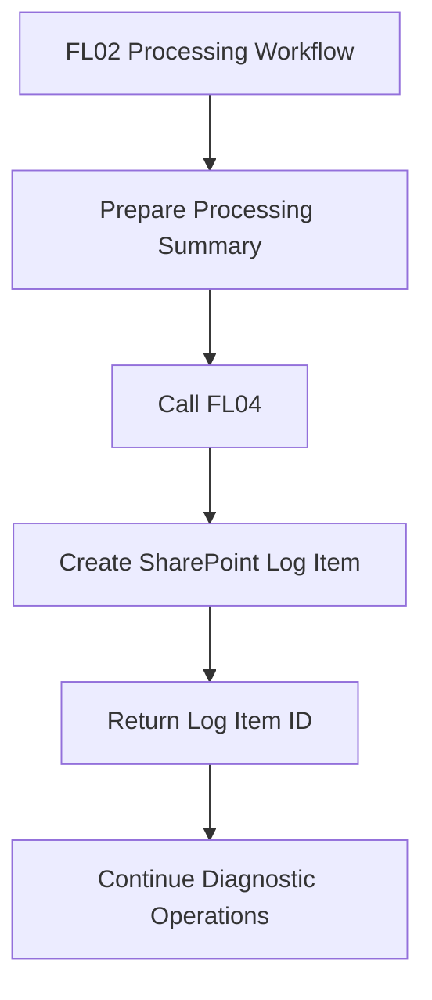

# Processing Logs List

## 1. Overview

The Processing Logs List is a SharePoint Online list located in the Management Subsite.

It provides centralized logging and traceability for automated document processing operations.

The list is populated by Power Automate FL04, which records execution information received from the processing workflow.

It supports operational monitoring, troubleshooting, and historical analysis.

> **Portfolio disclaimer:** This documentation describes a conceptual demonstration using fictional information. No production URLs, credentials, real identifiers, or confidential business data are included.

## 2. List Configuration

| Property | Configuration |
|---|---|
| List Name | Processing Logs |
| Location | Management Subsite |
| List Type | SharePoint Online List |
| Purpose | Execution logging and traceability |
| Record Creation | Power Automate FL04 |
| User Access | Read-only for Site Owners and Site Members |
| Center Groups | No access |
| Schema | Adaptable to implementation requirements |

## 3. Log Information

The list stores information about individual processing executions.

The exact columns can be adapted to the needs of each organization.

A demonstration implementation may include:

| Field | Suggested Type | Description |
|---|---|---|
| Execution ID | Single line of text | Identifier of the processing execution |
| Source File ID | Single line of text | Reference to the processed document |
| Processing Status | Choice | Result or current status of the processing |
| Records Created | Number | Number of successfully created records |
| SharePoint Errors | Number | Number of errors encountered during SharePoint operations |
| Error Details | Multiple lines of text | Detailed diagnostic information |
| Processing Summary | Multiple lines of text | Summary of the processing results |
| Execution Date | Date and time | Date and time associated with the execution |

These fields illustrate a possible logging structure and do not represent a mandatory SharePoint schema.

Additional fields can be introduced when required.

## 4. Integration with FL04

FL04 is responsible for creating processing log entries.

It receives information from the parent processing workflow and stores the corresponding results in SharePoint.

The integration provides:

- Centralized execution history.
- Processing result summaries.
- Error traceability.
- References to processed documents.
- Information for operational monitoring.

FL04 returns the created log item identifier to the calling workflow.

This identifier can be used for subsequent diagnostic or tracking operations.

## 5. Logging Workflow

The diagram represents the conceptual relationship between FL02 and FL04.

The exact input parameters and actions are documented in the corresponding Power Automate workflow files.

## 6. Error Tracking

The logging mechanism supports the recording of processing errors.

Depending on the implementation, error information may include:

- Failed SharePoint operations.
- Error descriptions.
- References to affected records.
- Processing execution identifiers.
- Partial processing results.

Error details should be structured to support troubleshooting while avoiding unnecessary exposure of sensitive information.

A processing execution may create some records successfully while also reporting errors.

Therefore, the log should distinguish between successful, partially successful, and failed processing outcomes when supported by the workflow.

## 7. Example Log Entries

The following examples use fictional information.

| Execution ID | Processing Status | Records Created | SharePoint Errors |
|---|---|---|---|
| DEMO-001 | Completed | 25 | 0 |
| DEMO-002 | Completed with Errors | 18 | 2 |
| DEMO-003 | Failed | 0 | 1 |

The example statuses and values are illustrative.

They do not define a mandatory set of SharePoint choice values.

## 8. Permissions

The Processing Logs List is restricted to authorized management users.

| Role | Permission |
|---|---|
| Site Collection Administrators | Administrative control |
| Site Owners | Read |
| Site Members | Read |
| Center Groups | No access |
| External Staff | No access |

Because Center Groups have general read access to the Management Subsite, the Processing Logs List must have appropriately restricted permissions.

Permission inheritance is interrupted where necessary to prevent unauthorized access.

## 9. Automated Write Access

FL04 creates log records using an authorized Power Automate connection.

Although ordinary Site Owners and Members have read-only access, the automation connection must have sufficient permissions to create list items.

This separates operational log creation from human access to historical records.

The connection identity and its permissions must be configured in the target environment.

## 10. Monitoring and Troubleshooting

The Processing Logs List can be used to:

1. Review historical processing executions.
2. Identify executions containing errors.
3. Compare created record counts.
4. Locate source document references.
5. Support investigation of processing failures.
6. Monitor recurring issues.

SharePoint views may be configured to filter or group entries by date, status, or other available fields.

Additional monitoring solutions can be integrated if required.

## 11. Data Retention and Security

Logging information should be managed according to organizational requirements.

Recommended considerations include:

- Defining a log retention period.
- Restricting access to authorized personnel.
- Avoiding storage of unnecessary personal data.
- Limiting sensitive information in error messages.
- Reviewing the permissions of automation connections.
- Monitoring log growth over time.
- Establishing a procedure for investigating failed executions.

The conceptual demonstration does not define a mandatory retention policy.

## 12. Related Documentation

- [Management Subsite](../sites/management-subsite.md)
- [SharePoint Sites Architecture](../architecture/sites-architecture.md)
- [SharePoint Overview](../README.md)

## 13. Documentation Status

**Status:** Conceptual logging list documentation complete.

The list schema may be extended according to operational monitoring requirements.

The exact SharePoint columns, permission assignments, and retention settings must be configured in the target environment.

This document is not an automated SharePoint provisioning template.
