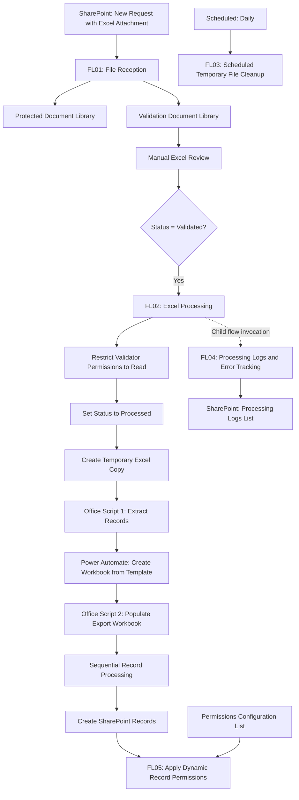

# Solution Architecture

## Overview

This project demonstrates an automated Excel processing pipeline using Microsoft Power Platform, SharePoint Online and Office Scripts.

The solution combines manual validation, automated data transformation, SharePoint record creation and dynamic permission management.

## Architecture Diagram



## Main Components

### FL01: File Reception

Receives requests containing Excel attachments and creates copies in two SharePoint document libraries:

- Protected library for administrative access.
- Validation library for authorized reviewers.

### FL02: Excel Processing

Triggered when a file is marked as validated.

The workflow restricts editing permissions, updates the processing status, extracts Excel data, generates output files and creates related SharePoint records.

Primary and associated records are processed sequentially to preserve their relationships.

### FL03: Temporary File Cleanup

Scheduled workflow that removes temporary processing files older than eight hours.

### FL05: Dynamic Permissions

Triggered when a SharePoint record is created.

Uses a configuration list to determine the appropriate security groups and applies record-level permissions.

## Security

This architecture represents an independent demonstration using fictional data and generic configurations.

No proprietary corporate components, credentials or internal configurations are included.
```

