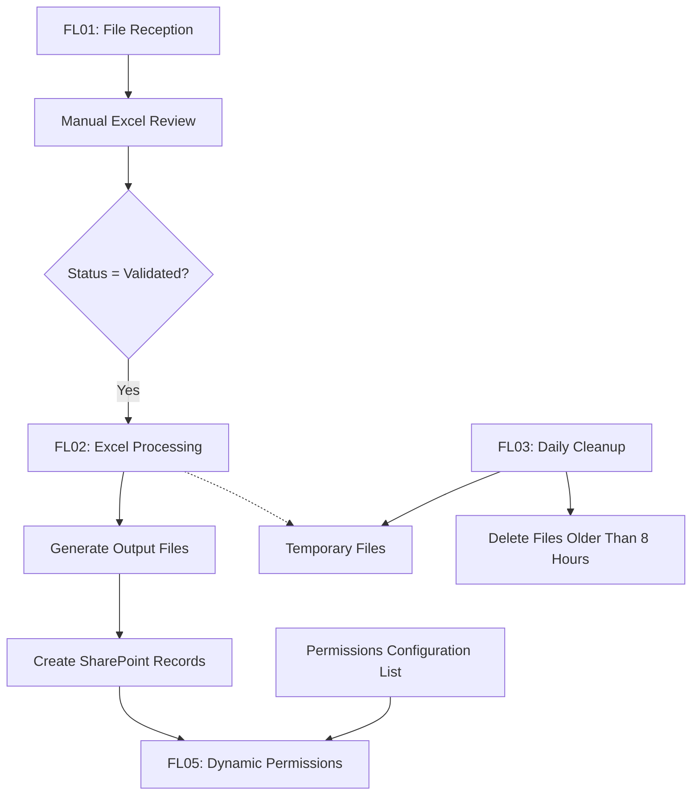

# Solution Architecture

## Overview

This project demonstrates an automated Excel processing pipeline using Microsoft Power Platform.

## Main components

- SharePoint: Data registration and document storage
- Power Automate: Workflow orchestration
- Office Scripts: Excel data processing
- FL01: File reception and permission management
- FL02: File validation and transformation
- FL03: Temporary file cleanup
- FL05: Record-level permission management

## Architecture status

The detailed workflow diagram is being prepared.

All components will be recreated independently using fictional data and generic configurations.

  
