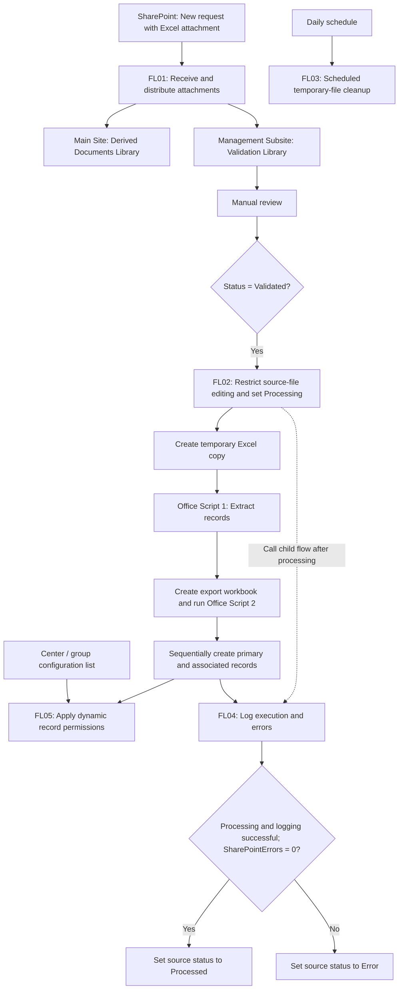

# Solution Architecture

## Overview

This project demonstrates an automated Excel processing pipeline using Microsoft Power Platform, SharePoint Online and Office Scripts.

The solution combines manual validation, automated data transformation, SharePoint record creation and dynamic permission management.

## Architecture Diagram



## Main Components

### FL01: File Reception

Receives requests containing Excel attachments and creates copies in two SharePoint document libraries:

- Derived Documents Library in the Main Site for read-only access by authorized users.
- Validation Library in the Management Subsite for restricted internal review and processing.

### FL02: Excel Processing

Triggered when a file is marked as validated.

The workflow restricts editing permissions on the source document and sets its status to `Processing`. It then extracts Excel data, generates output files, creates related SharePoint records, and invokes FL04 to log the execution. Once processing and logging are evaluated, it sets the source status to `Processed` on success with `SharePointErrors = 0`, or `Error` on failure.

Primary and associated records are processed sequentially to preserve their relationships. This diagram summarizes conceptual responsibilities rather than an executable flow package; detailed error paths and action order are described in [FL02 documentation](../flows/FL02-demo/README.md).

### FL03: Temporary File Cleanup

Scheduled workflow that removes temporary processing files older than eight hours.

### FL04: Processing Logs and Error Tracking

Reusable child flow invoked by FL02 to centralize processing logs and error reporting.

The flow receives execution information, including the source file, processing reference, record counts, error details and execution identifier.

It creates a SharePoint log entry to provide traceability and support troubleshooting.

This separation keeps the main processing workflow focused on business operations while delegating execution logging to a dedicated component.


### FL05: Dynamic Permissions

Triggered when a SharePoint record is created.

Uses a configuration list to determine the appropriate security groups and applies record-level permissions.

## Security

This architecture represents an independent demonstration using fictional data and generic configurations.

No proprietary corporate components, credentials or internal configurations are included.
```

