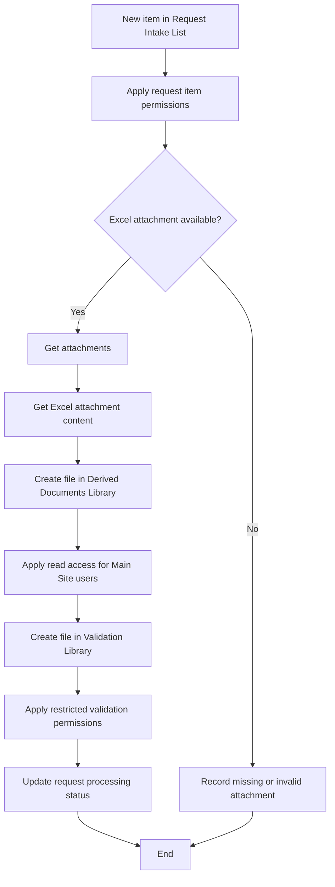

# FL01 - SharePoint File Reception and Distribution

## Overview

Demonstration of a Power Automate workflow designed to receive Excel attachments from a SharePoint list and distribute them to two document libraries.

All names, identifiers and data are fictional.

## Architecture

### Workflow Diagram

**Trigger:** SharePoint - When an item is created in the Request Intake List.

**Process:**

1. Detect a new request submitted through the SharePoint Request Intake List.
2. Apply item-level permissions to the submitted request.
3. Retrieve the attachments associated with the request.
4. Identify and retrieve the Excel workbook (.xlsx).
5. Create a document copy in the Derived Documents Library, located in the Main Site.
6. Ensure read access to the Derived Documents Library for all authorized Main Site users.
7. Create a second document copy in the Validation Library, located in the Management Subsite.
8. Apply the restricted permission model required for internal validation.
9. Update the request processing status and relevant metadata.
10. Complete the workflow.

## SharePoint Components

FL01 starts when a new request is created in the SharePoint Request Intake List.

Each request is a SharePoint list item containing observations and an attached Excel workbook.

The workflow retrieves the attachments and creates document copies in two SharePoint libraries.

| Component | Location | Purpose |
|---|---|---|
| Request Intake List | Main Site | Stores request records, observations, and Excel attachments. |
| Derived Documents Library | Main Site | Stores document copies generated from requests. All site users have read access. |
| Validation Library | Management Subsite | Stores Excel copies for internal validation and subsequent processing. Access is restricted to authorized management users. |

The Request Intake List is the entry point of the process. It is not a document library.

The Derived Documents Library provides read-only access to documents for all authorized users of the Main Site.

The Validation Library is located in the Management Subsite and follows a separate, restricted permission model.

## Permissions

FL01 uses different permission models for the request item and the document copies created during processing.

| SharePoint Resource | External Staff | Site Members | Site Owners |
|---|---|---|---|
| Request Intake List | Create requests and read authorized items | Read | Read |
| Derived Documents Library | Read | Read | Read |
| Validation Library | No access | Edit during validation | Edit during validation |

### Request Intake List

External staff submit requests through SharePoint list items containing observations and Excel attachments.

FL01 applies item-level permissions to control access to submitted requests.

### Derived Documents Library

The library is located in the Main Site.

All authorized Main Site users have read access to the documents.

The workflow uses an authorized service connection to create and manage document copies.

### Validation Library

The library is located in the Management Subsite.

External staff and center groups do not have access.

Authorized management users can modify documents during the validation stage.

After FL02 processes a validated document, it applies read-only permissions to Site Members and Site Owners. Site Collection Administrators retain administrative modification capabilities.

### Security Considerations

- SharePoint permissions enforce access restrictions.
- JSON interface customizations do not replace security permissions.
- Automation connections require appropriate permissions to create files and update access.
- Site Collection Administrators retain administrative control.
- The permission model must be tested in a demonstration environment before production use.

## Implementation Status

**Conceptual demonstration. Not an importable Power Automate flow.**

The FL01-demo.json file documents the intended workflow architecture.

SharePoint permissions, metadata updates and attachment processing must be implemented and tested in an appropriate environment.

## Security

- Fictional SharePoint resources.
- No real user data.
- No credentials or connection identifiers.
- No corporate solution exports.

## Technical Highlights

This conceptual workflow demonstrates the design of a SharePoint-based document automation process using Microsoft Power Automate.

### SharePoint Permission Management
- Break permission inheritance on SharePoint list items and original documents.
- Assign read-only access to the item creator.
- Apply different access levels to original and validation documents.
- Use SharePoint groups to manage document permissions.

### Document Automation
- Trigger a workflow when a new SharePoint list item is created.
- Retrieve attachments and their content.
- Create documents in separate SharePoint libraries.
- Support a document validation process.

### Metadata and Process Tracking
- Update SharePoint list item properties.
- Retrieve and update document metadata.
- Record processing information across different stages.
- Maintain traceability between requests and related documents.

### Architecture and Documentation
- Document workflow architecture using Mermaid diagrams.
- Describe workflow components using structured JSON.
- Separate conceptual design from executable Power Automate definitions.
- Use fictional resources to demonstrate technical concepts without exposing corporate information.

**Implementation note:** This repository contains a conceptual demonstration. The workflow has not been deployed or tested as an executable solution in the demonstration environment.

## Technologies

- Microsoft Power Automate
- SharePoint Online
- JSON

