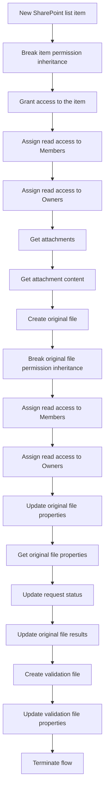

# FL01 - SharePoint File Reception and Distribution

## Overview

Demonstration of a Power Automate workflow designed to receive Excel attachments from a SharePoint list and distribute them to two document libraries.

All names, identifiers and data are fictional.

## Architecture

### Workflow Diagram

**Trigger:** When an item is created in `SolicitudesDemo`.

**Process:**

1. Detect a new SharePoint list item.
2. Check whether attachments exist.
3. Retrieve each attachment.
4. Process Excel files (.xlsx).
5. Create a copy in `DocumentosEntradaDemo`.
6. Create a copy in `DocumentosValidacionDemo`.
7. Associate document metadata.
8. Record the processing result.

## SharePoint Components

| Component | Purpose |
|---|---|
| SolicitudesDemo | Request intake list |
| DocumentosEntradaDemo | Restricted document library |
| DocumentosValidacionDemo | Validation document library |

## Permissions

The workflow applies different permission levels depending on the SharePoint resource.

| SharePoint Resource | Item Creator | Members | Owners |
|---|---|---|---|
| SharePoint list item | Read | Read | Read |
| Original document | No access | Read | Read |
| Validation document | No access | Edit | Edit |

### Permission Management

- **Item Creator:** Read-only access to the SharePoint list item. No access to the generated documents.
- **Members:** Read access to the list item and original document. Edit access to the validation document.
- **Owners:** Read access to the list item and original document. Edit access to the validation document.

Permission inheritance is broken for the SharePoint list item and the original document.

All group names and SharePoint resources used in this demonstration are fictional.

## Implementation Status

**Conceptual demonstration. Not an importable Power Automate flow.**

The FL01-demo.json file documents the intended workflow architecture.

SharePoint permissions, metadata updates and attachment processing must be implemented and tested in an appropriate environment.

## Security

- Fictional SharePoint resources.
- No real user data.
- No credentials or connection identifiers.
- No corporate solution exports.

## Technical Highlights

This conceptual workflow demonstrates the design of a SharePoint-based document automation process using Microsoft Power Automate.

### SharePoint Permission Management
- Break permission inheritance on SharePoint list items and original documents.
- Assign read-only access to the item creator.
- Apply different access levels to original and validation documents.
- Use SharePoint groups to manage document permissions.

### Document Automation
- Trigger a workflow when a new SharePoint list item is created.
- Retrieve attachments and their content.
- Create documents in separate SharePoint libraries.
- Support a document validation process.

### Metadata and Process Tracking
- Update SharePoint list item properties.
- Retrieve and update document metadata.
- Record processing information across different stages.
- Maintain traceability between requests and related documents.

### Architecture and Documentation
- Document workflow architecture using Mermaid diagrams.
- Describe workflow components using structured JSON.
- Separate conceptual design from executable Power Automate definitions.
- Use fictional resources to demonstrate technical concepts without exposing corporate information.

**Implementation note:** This repository contains a conceptual demonstration. The workflow has not been deployed or tested as an executable solution in the demonstration environment.

## Technologies

- Microsoft Power Automate
- SharePoint Online
- JSON

