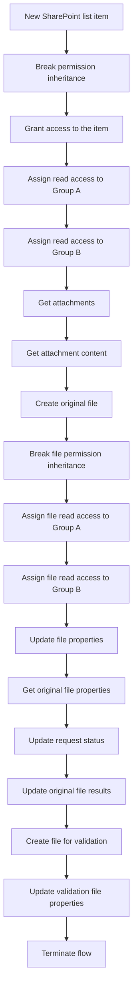

# FL01 - SharePoint File Reception and Distribution

## Overview

Demonstration of a Power Automate workflow designed to receive Excel attachments from a SharePoint list and distribute them to two document libraries.

All names, identifiers and data are fictional.

## Architecture

### Workflow Diagram

**Trigger:** When an item is created in `SolicitudesDemo`.

**Process:**

1. Detect a new SharePoint list item.
2. Check whether attachments exist.
3. Retrieve each attachment.
4. Process Excel files (.xlsx).
5. Create a copy in `DocumentosEntradaDemo`.
6. Create a copy in `DocumentosValidacionDemo`.
7. Associate document metadata.
8. Record the processing result.

## SharePoint Components

| Component | Purpose |
|---|---|
| SolicitudesDemo | Request intake list |
| DocumentosEntradaDemo | Restricted document library |
| DocumentosValidacionDemo | Validation document library |

## Permissions

- AdministradoresDemo: access to both libraries.
- ValidadoresDemo: access to the validation library.

## Implementation Status

**Conceptual demonstration. Not an importable Power Automate flow.**

The FL01-demo.json file documents the intended workflow architecture.

SharePoint permissions, metadata updates and attachment processing must be implemented and tested in an appropriate environment.

## Security

- Fictional SharePoint resources.
- No real user data.
- No credentials or connection identifiers.
- No corporate solution exports.

## Technologies

- Microsoft Power Automate
- SharePoint Online
- JSON

