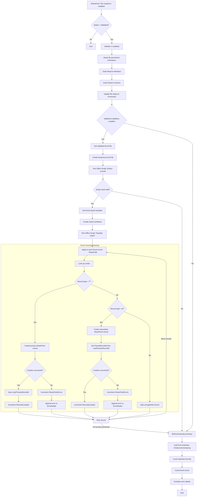
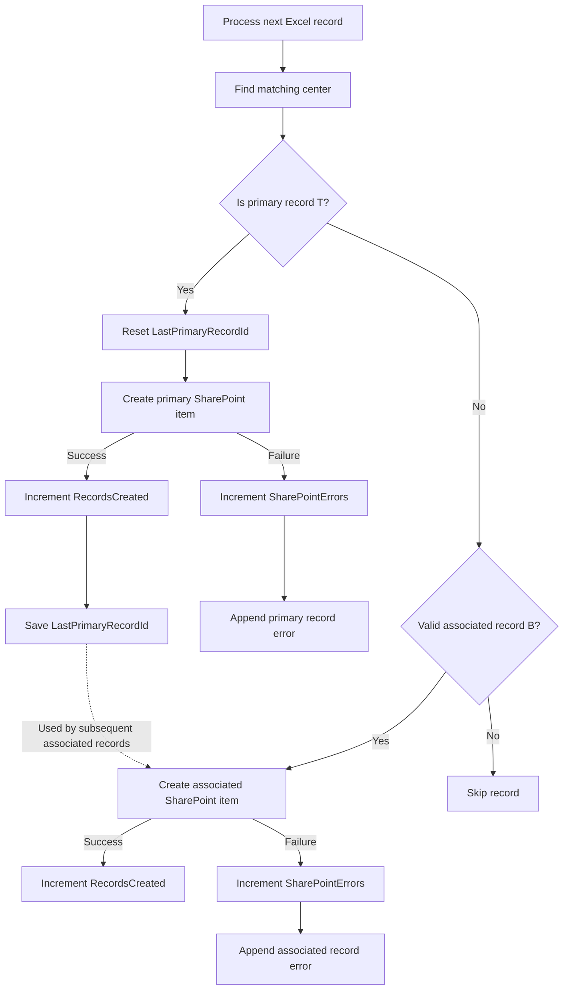

# FL02 - Excel Processing and Record Creation

## Overview

FL02 is the main Power Automate workflow responsible for processing validated Excel files, generating output workbooks, and creating related records in SharePoint Online.

It orchestrates SharePoint document management, Office Scripts, sequential record processing, error tracking, and execution logging through the FL04 child flow.

This is an independent conceptual demonstration using fictional data.

## Architecture



## Trigger

**SharePoint - When a file is created or modified (properties only)**

The workflow uses a trigger condition that checks whether the file status is `Validated`.

An additional condition is used before the main processing operations.

## Initialization

The workflow initializes four variables:

| Variable | Type | Purpose |
|---|---|---|
| SharePointErrors | Integer | Counts SharePoint record creation errors |
| LastPrimaryRecordId | Integer | Stores the last successfully created primary record ID |
| ErrorDetails | Array | Collects processing error details |
| RecordsCreated | Integer | Counts successfully created records |

## Document Permission Management

Before processing the Excel file, the workflow:

1. Breaks permission inheritance on the source document.
2. Grants Read permissions to the configured Members group.
3. Grants Read permissions to the configured Owners group.

This restricts editing during processing.

## Document Status

The file status changes from `Validated` to `Processed` before the main processing operations finish.

**Important:** `Processed` indicates that the workflow has entered the processing stage. It does not guarantee successful completion.

## Excel Processing

The workflow performs the following operations:

1. Retrieve the validated source workbook.
2. Create a temporary working copy.
3. Execute `process-records.ts` to extract Excel records.
4. Check the Office Script result.
5. Retrieve the predefined export template.
6. Create a new Excel export workbook.
7. Execute `populate-export-template.ts` to populate the template.
8. Continue with SharePoint record creation.

The export script writes data into the predefined template starting at row 15.

## Sequential Record Processing

The workflow distinguishes two types of records:

| Record Type | Description |
|---|---|
| T | Primary record |
| B | Associated record |

Records are processed sequentially, with concurrency limited to one iteration at a time.

This preserves the source order and allows associated records to reference the correct primary record.

### Record Relationship Diagram



## Composite Family Identifier

The workflow constructs a family identifier by combining the source SharePoint file ID and the family identifier from Excel.

Example:

```text
SourceFileId = 125
FamilyId = FAM003
CompositeFamilyId = 125-FAM003
```

This helps distinguish records originating from different source files.

## Error Tracking

The workflow maintains:

- A counter for SharePoint record creation errors.
- An array containing error details.
- A counter for successfully created records.
- A processing summary containing the reference ID, created records, errors, and error details.

Separate branches track successful and failed record creation operations.

## Integration with FL04

FL02 invokes FL04 as a child flow and passes eight input parameters:

| Parameter | Purpose |
|---|---|
| ProcessingReferenceId | Identifies the processing operation |
| SourceFileId | Identifies the source file |
| SourceFileName | Identifies the processed workbook |
| RecordsRead | Number of records read |
| RecordsCreated | Number of records created |
| RecordsWithErrors | Number of SharePoint errors |
| ErrorDetails | Processing error details |
| ExecutionId | Flow execution identifier |

FL04 creates a SharePoint log entry and returns its ID as `Id_Log`.

## Related Workflows

| Flow | Relationship |
|---|---|
| FL01 | Prepares documents for validation |
| FL03 | Cleans up temporary files older than 8 hours |
| FL04 | Receives processing results and creates execution logs |
| FL05 | Applies dynamic permissions to newly created SharePoint records |

FL03 operates independently on a schedule, while FL04 is directly invoked by FL02.

## Technologies

- Microsoft Power Automate
- SharePoint Online
- Excel Online (Business)
- Office Scripts
- TypeScript
- JSON
- SharePoint permission management
- Mermaid

## Technical Highlights

- Metadata-driven automation.
- Document lifecycle and permission management.
- Office Scripts orchestration.
- Excel export generation.
- Sequential processing and parent-child record relationships.
- Composite identifiers.
- Array-based error tracking.
- Reusable child flow integration.
- SharePoint execution logging.

### FL04 Child Flow Input Contract

FL02 invokes FL04 to create a centralized processing log.

The child flow expects eight input parameters:

| Parameter | Expected Source |
|---|---|
| ProcessingReferenceId | Current processing reference |
| SourceFileId | SharePoint source file identifier |
| SourceFileName | Original Excel file name |
| RecordsRead | Number of records extracted from the workbook |
| RecordsCreated | Successfully created SharePoint records |
| RecordsWithErrors | Total number of records with processing errors |
| ErrorDetails | Consolidated processing error details |
| ExecutionId | Current Power Automate execution identifier |

FL04 returns `Id_Log`, the identifier of the created SharePoint log item.

**Implementation note:** The conceptual FL02 JSON currently declares an eight-parameter child flow invocation without defining the individual input mappings.

The final implementation must explicitly map all eight parameters, calculate RecordsWithErrors consistently, and validate that the values are available before invoking FL04.

SharePointErrors and RecordsWithErrors must not be treated as equivalent unless the implementation explicitly defines and validates that relationship.


## Implementation Status

**Conceptual demonstration. Not an importable Power Automate flow.**

The `FL02-demo.json` file represents the workflow architecture and does not contain executable Power Automate action definitions.

## Security

- Fictional SharePoint site and list names.
- Fictional records and identifiers.
- No real user data.
- No credentials or corporate URLs.
- No proprietary solution exports.


