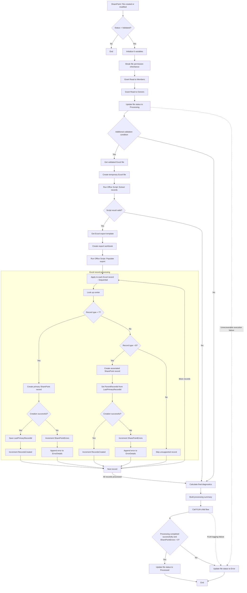
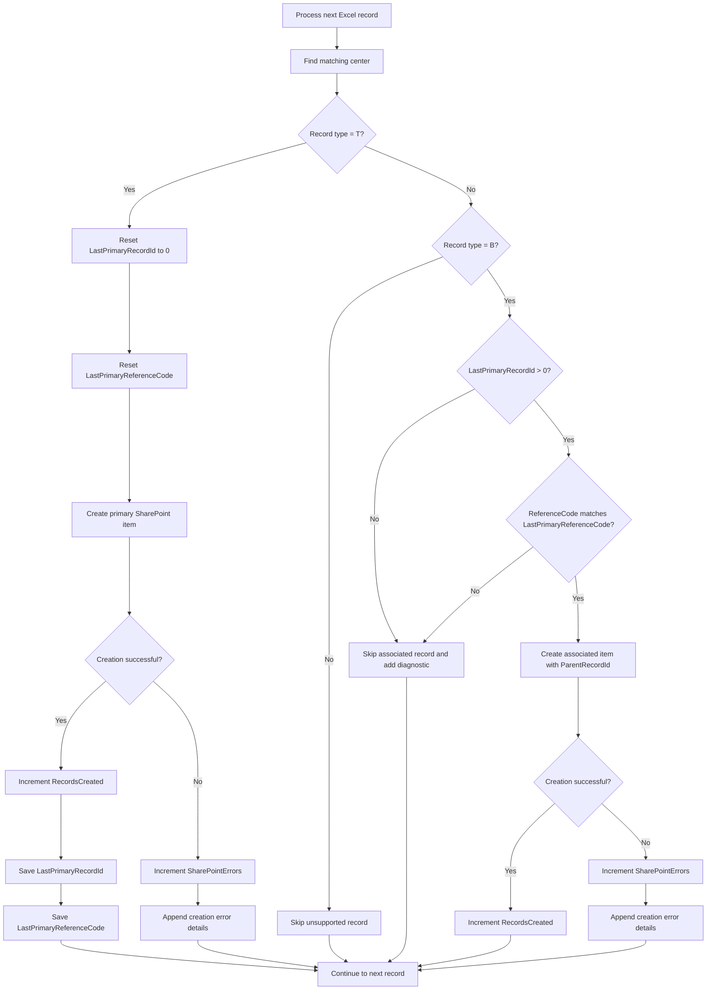

# FL02 - Excel Processing and Record Creation

## Overview

FL02 is the main Power Automate workflow responsible for processing validated Excel files, generating output workbooks, and creating related records in SharePoint Online.

It orchestrates SharePoint document management, Office Scripts, sequential record processing, error tracking, and execution logging through the FL04 child flow.

This is an independent conceptual demonstration using fictional data.

## Architecture



The architecture diagram illustrates the conceptual processing workflow.

The source file is marked as `Processing` before Excel operations begin.

After processing and logging, the workflow determines whether the file should be marked as `Processed` or `Error`.

Dashed arrows represent conceptual exception paths. They do not imply executable Power Automate error handling.

## Trigger

**SharePoint - When a file is created or modified (properties only)**

The workflow uses a trigger condition that checks whether the file status is `Validated`.

An additional condition is used before the main processing operations.

Changing the file status to `Processing` prevents subsequent file modifications from satisfying the `Validated` trigger condition.


## Initialization

The workflow initializes six variables:

| Variable | Type | Purpose |
|---|---|---|
| SharePointErrors | Integer | Counts failed SharePoint record creation operations |
| RecordsWithErrors | Integer | Stores the final number of records whose SharePoint creation failed |
| LastPrimaryRecordId | Integer | Stores the last successfully created primary record ID |
| LastPrimaryReferenceCode | String | Stores the ReferenceCode of the last successfully created primary record |
| ErrorDetails | Array | Collects SharePoint record creation error details |
| RecordsCreated | Integer | Counts successfully created SharePoint records |

### Primary Record Tracking

When a new primary record (`T`) is processed:

1. Reset `LastPrimaryRecordId` to `0`.
2. Reset `LastPrimaryReferenceCode` to an empty string.
3. Attempt to create the primary SharePoint record.
4. If creation succeeds, save the new item ID and its `ReferenceCode`.
5. If creation fails, keep both tracking variables reset.

These variables allow associated records (`B`) to be linked only to a successfully created primary record with a matching `ReferenceCode`.

### Error Counter Initialization

In this conceptual demonstration, `RecordsWithErrors` is calculated from `SharePointErrors` during final diagnostics.

Both values represent the number of failed SharePoint record creation operations.

## Document Permission Management

Before processing the Excel file, the workflow:

1. Breaks permission inheritance on the source document.
2. Grants Read permissions to the configured Members group.
3. Grants Read permissions to the configured Owners group.

This restricts editing during processing.

## Document Status

FL02 manages the source document lifecycle using four conceptual SharePoint status values.

### Status Definitions

| Status | Description |
|---|---|
| Validated | The document has been validated and is ready for processing |
| Processing | The workflow has started processing the document |
| Processed | Processing and execution logging completed successfully without SharePoint record creation errors |
| Error | Processing failed, SharePoint record creation errors occurred, or execution logging failed |

### Status Transitions

| Previous Status | New Status | Condition |
|---|---|---|
| Validated | Processing | FL02 starts processing the validated document |
| Processing | Processed | Main processing and FL04 logging succeed, with SharePointErrors = 0 |
| Processing | Error | Main processing fails, SharePointErrors > 0, or FL04 logging fails |

### Processing Status

At the beginning of execution, FL02 updates the source file status from `Validated` to `Processing`.

This distinguishes documents currently being processed from documents that have completed processing.

The trigger condition only accepts files with status `Validated`, helping prevent duplicate executions caused by subsequent metadata updates.

### Successful Completion

After completing the main processing operations, FL02 prepares the execution diagnostics and invokes FL04.


If processing and logging complete successfully and no SharePoint record creation errors are reported, FL02 updates the source document status to `Processed`.

The `Processed` status indicates successful completion of the main processing workflow and the FL04 logging operation.

### Error Handling

If the main processing workflow fails, SharePoint record creation errors are detected, or FL04 logging fails, the source document is marked as `Error`.

The error status helps identify documents that require investigation or corrective action.

Partial record creation is considered an error at the document level, even when some SharePoint records were successfully created.

### Relationship with FL04 Status

The source document status and the FL04 execution status serve different purposes.

| Source Document Status | FL04 Processing Status | Scenario |
|---|---|---|
| Processed | Success | Processing completed successfully with records created and no SharePoint creation errors |
| Processed | No Records | Processing completed successfully but no records were created |
| Error | Partial Success | Some records were created and others failed |
| Error | Error | No records were created and SharePoint creation errors occurred |
| Error | Not available | Processing or logging failed before a log entry could be created |

A `No Records` log status does not automatically guarantee successful completion. The main workflow must also complete successfully.

### Implementation Considerations

The conceptual JSON defines `MarkFileAsProcessing`, `MarkFileAsProcessed`, and `MarkFileAsError`.

In a production implementation, Power Automate should use appropriate `Scope` actions, conditions, and `Configure run after` settings to manage success, failure, skipped, and timeout scenarios.

The error handling branch must be able to execute even when an earlier processing action fails.

Status updates should be designed to avoid unnecessary trigger executions and ensure that documents do not remain indefinitely in `Processing`.

## Excel Processing

The workflow performs the following operations:

1. Retrieve the validated source workbook.
2. Create a temporary working copy.
3. Execute `process-records.ts` to extract Excel records.
4. Check the Office Script result.
5. Retrieve the predefined export template.
6. Create a new Excel export workbook.
7. Execute `populate-export-template.ts` to populate the template.
8. Continue with SharePoint record creation.

The export script writes data into the predefined template starting at row 15.

## Sequential Record Processing

### Source Record Type Validation

Before FL02 processes individual records, the `process-records.ts` Office Script validates the source Excel data.

Only two record types are supported:

- `T`: Primary record.
- `B`: Associated record.

If a record contains an unsupported `RecordType`, the Office Script throws an error identifying the affected row.

The Excel extraction fails, and FL02 must handle this as a document-level processing error.

Unsupported record types are therefore not silently skipped during normal processing.

This validation error does not increment `SharePointErrors` or `RecordsWithErrors`, because no SharePoint record creation was attempted.

The workflow distinguishes two types of records:

| Record Type | Description |
|---|---|
| T | Primary record |
| B | Associated record |

Records are processed sequentially, with concurrency limited to one iteration at a time.

This preserves the source order and allows associated records to reference the correct primary record.

### Record Relationship Diagram



## Composite Family Identifier

The workflow constructs a family identifier by combining the source SharePoint file ID and the `ReferenceCode` extracted from Excel.

Example:

```text
SourceFileId = 125
ReferenceCode = FAM003
CompositeFamilyId = 125-FAM003
```

This helps distinguish records originating from different source files.

## Record Ordering and Relationship Validation

FL02 processes Excel records sequentially, with concurrency set to one.

The current conceptual implementation assumes that each primary record (`T`) appears before its associated records (`B`).

For an associated record to be created:

1. `LastPrimaryRecordId` must be greater than zero.
2. Its `ReferenceCode` must match `LastPrimaryReferenceCode`.

If either condition fails, the associated record is skipped and a diagnostic entry is added.

Skipped records do not increment `SharePointErrors`, because no SharePoint creation operation was attempted.

### Example

| Order | Type | ReferenceCode | Expected Behavior |
|---|---|---|---|
| 1 | T | FAM001 | Create primary record and save its ID |
| 2 | B | FAM001 | Associate with FAM001 primary record |
| 3 | B | FAM002 | Skip because the reference does not match |
| 4 | T | FAM002 | Create new primary record |
| 5 | B | FAM002 | Associate with FAM002 primary record |

### Known Limitation

The current design does not support associated records appearing before their corresponding primary records.

It also does not search previously created primary records by `ReferenceCode`.

A future implementation could maintain a mapping between `ReferenceCode` and SharePoint item IDs to support records in any order.

## Error Tracking

The workflow maintains:

- A counter for SharePoint record creation errors.
- An array containing error details.
- A counter for successfully created records.
- A processing summary containing the reference ID, created records, errors, and error details.

Separate branches track successful and failed record creation operations.

### Error Counting Model

The workflow counts errors occurring during SharePoint record creation.

| Metric | Definition |
|---|---|
| SharePointErrors | Number of failed record creation operations in the Processed Records List |
| RecordsWithErrors | Number of records whose creation in SharePoint failed |
| ErrorDetails | Diagnostic information describing SharePoint record creation failures |
| RecordsCreated | Number of successfully created SharePoint records |

In this demonstration, each failed record creation operation corresponds to one failed record.

Therefore:

`RecordsWithErrors = SharePointErrors`

Excel validation errors, unsupported record types, and general workflow failures are not included in RecordsWithErrors.

FL02 passes the SharePointErrors counter directly to FL04 as RecordsWithErrors.

FL04 uses this value together with RecordsCreated to determine the processing status.

### Document-Level Error Handling

The source document status is managed independently from the FL04 processing status.

If SharePoint record creation errors occur, the source document is marked as `Error`, even when some records were created successfully.

Failures in Excel processing or FL04 logging must also be handled by the document-level error branch.

These failures are not automatically included in the `RecordsWithErrors` counter.

## Integration with FL04

FL02 invokes FL04 as a child flow and passes eight input parameters:

| Parameter | Purpose |
|---|---|
| ProcessingReferenceId | Identifies the processing operation |
| SourceFileId | Identifies the source file |
| SourceFileName | Identifies the processed workbook |
| RecordsRead | Number of records read |
| RecordsCreated | Number of records created |
| RecordsWithErrors | Number of SharePoint record creation errors |
| ErrorDetails | Processing error details |
| ExecutionId | Flow execution identifier |

FL04 creates a SharePoint log entry and returns its ID as `Id_Log`.

### FL04 Child Flow Input Contract

The conceptual workflow defines eight input mappings:

| Parameter | FL02 Source |
|---|---|
| ProcessingReferenceId | CurrentProcessingReferenceId |
| SourceFileId | TriggerFileId |
| SourceFileName | TriggerFileName |
| RecordsRead | CalculatedRecordsRead |
| RecordsCreated | RecordsCreated |
| RecordsWithErrors | SharePointErrors |
| ErrorDetails | ConsolidatedErrorDetails |
| ExecutionId | CurrentFlowExecutionId |

### Error Counting and Status

In this demonstration, `RecordsWithErrors` represents the number of failed SharePoint record creation operations.

Each failed operation corresponds to one failed record.

Therefore:

`RecordsWithErrors = SharePointErrors`

Excel validation errors, unsupported record types, and general workflow failures are excluded from this counter.

FL04 determines the processing status using `RecordsCreated` and `RecordsWithErrors`:

| Status | Condition |
|---|---|
| Success | RecordsCreated > 0 AND RecordsWithErrors = 0 |
| Partial Success | RecordsCreated > 0 AND RecordsWithErrors > 0 |
| Error | RecordsCreated = 0 AND RecordsWithErrors > 0 |
| No Records | RecordsCreated = 0 AND RecordsWithErrors = 0 |

These statuses describe SharePoint record creation outcomes and do not replace the source document lifecycle status.

### Child Flow Output

FL04 creates a record in the `Processing Logs List` and returns its SharePoint item ID as `Id_Log`.

### Implementation Note

All eight input mappings are explicitly documented in `FL02-demo.json`.

The JSON describes the conceptual integration between FL02 and FL04. It is not an importable or executable Power Automate flow definition.

A production implementation would need to implement these mappings using actual Power Automate actions and expressions, including validation of the required values before invoking FL04.

Error handling must also account for failures that prevent FL04 from executing.

## Related Workflows

| Flow | Relationship |
|---|---|
| FL01 | Prepares documents for validation |
| FL03 | Cleans up temporary files older than 8 hours |
| FL04 | Receives processing results and creates execution logs |
| FL05 | Applies dynamic permissions to newly created SharePoint records |

FL03 operates independently on a schedule, while FL04 is directly invoked by FL02.


## Technologies

- Microsoft Power Automate
- SharePoint Online
- Excel Online (Business)
- Office Scripts
- TypeScript
- JSON
- SharePoint permission management
- Mermaid

## Technical Highlights

- Metadata-driven automation.
- Document lifecycle and permission management.
- Four-state document lifecycle: Validated, Processing, Processed, Error.
- Office Scripts orchestration.
- Excel export generation.
- Sequential processing and parent-child record relationships.
- Composite identifiers.
- Array-based error tracking.
- SharePoint record creation error counting.
- Reusable child flow integration.
- Centralized execution logging through FL04.
- Conceptual success and error handling branches.

## Implementation Status

**Conceptual demonstration. Not an importable Power Automate flow.**

The `FL02-demo.json` file represents the workflow architecture and does not contain executable Power Automate action definitions.

The demonstration documents the intended behavior of the workflow, including trigger conditions, processing operations, error tracking, document status transitions, and child flow integration.

A production implementation would require:

- Configuring actual Power Automate triggers and actions.
- Implementing the described conditions and expressions.
- Configuring sequential execution for record processing.
- Implementing exception handling with Scopes and Configure run after.
- Validating the SharePoint list and library schemas.
- Testing Office Scripts with the expected Excel templates.
- Testing document status transitions and error recovery.
- Verifying FL04 child flow execution and output handling.

## Security

- Fictional SharePoint site and list names.
- Fictional records and identifiers.
- No real user data.
- No credentials or corporate URLs.
- No proprietary solution exports.
- Conceptual SharePoint permissions documented for demonstration purposes.
