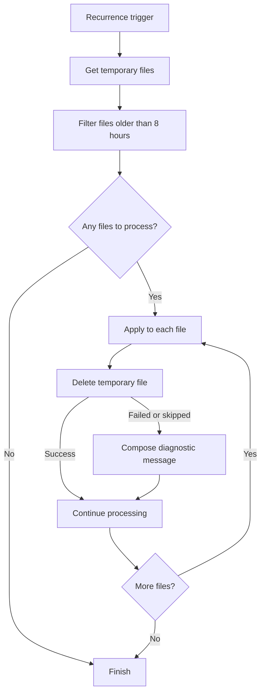

# FL03 - Temporary File Cleanup

## Overview

Conceptual demonstration of a scheduled Power Automate workflow that removes temporary SharePoint files older than 8 hours.

All SharePoint resources and identifiers are fictional.

## Architecture

### Workflow Diagram

## Workflow Steps

1. Run on a recurring schedule.
2. Retrieve temporary files from a SharePoint document library.
3. Filter files older than 8 hours.
4. Iterate through the filtered files.
5. Delete each selected file.
6. Generate a diagnostic message if deletion fails or is skipped.

## Retention Policy

| Setting | Value |
|---|---|
| File age threshold | More than 8 hours |
| Target | Temporary SharePoint files |
| Execution | Recurring schedule |
| Exact recurrence frequency | Not specified |

## Diagnostic Handling

If a deletion action fails or is skipped, a Compose action generates a diagnostic message identifying the affected file and suggesting a check for an Excel Online lock.

This is a diagnostic step, not a complete error logging or notification system.

## Technical Highlights

- Scheduled cloud flow design.
- SharePoint document library operations.
- Array filtering based on file age.
- Apply to each processing.
- Automated deletion of temporary files.
- Conditional execution using Run after.
- Diagnostic messages for failed or skipped operations.

## Implementation Status

**Conceptual demonstration. Not an importable Power Automate flow.**

The FL03-demo.json file describes the intended architecture and does not contain executable Power Automate action definitions.

## Security

- Fictional SharePoint resources.
- No real user data.
- No credentials or connection identifiers.
- No corporate solution exports.

## Technologies

- Microsoft Power Automate
- SharePoint Online
- JSON
- Mermaid
