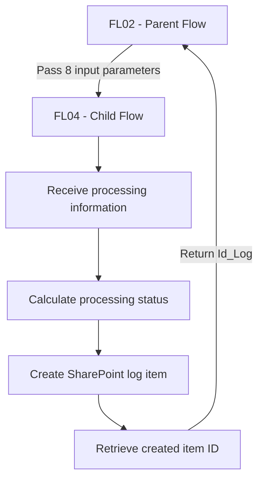

# FL04 - Processing Logs and Error Tracking

## Overview

FL04 is a reusable Power Automate child flow that records processing results and errors in a SharePoint Online list.

It is invoked by FL02, the parent Excel processing workflow, and returns the identifier of the newly created log entry.

This conceptual demonstration illustrates centralized logging, execution traceability, and reusable automation components.

## Architecture

## Trigger

**Manually trigger a flow**

FL04 is called by FL02 and receives eight input parameters.

## Input Parameters

| Parameter | Type | Description |
|---|---|---|
| ProcessingReferenceId | Number | Reference identifier for the processing operation |
| SourceFileId | Number | Identifier of the source file |
| SourceFileName | Text | Name of the processed Excel file |
| RecordsRead | Number | Number of records read |
| RecordsCreated | Number | Number of records created |
| RecordsWithErrors | Number | Number of records with errors |
| ErrorDetails | Text | Details of processing errors |
| ExecutionId | Text | Identifier used for execution traceability |

## Workflow Steps

1. Receive processing parameters from FL02.
2. Evaluate the processing results to determine the execution status.
3. Generate the execution timestamp using `utcNow()`.
4. Create a new item in the SharePoint processing log list.
5. Store processing counts, error details, and execution identifiers.
6. Retrieve the ID of the created SharePoint item.
7. Return `Id_Log` to the parent flow.

## Processing Status Logic

The workflow determines the processing status based on the number of successfully created records and records with errors.

| Records Created | Records With Errors | Status |
|---|---|---|
| Greater than 0 | 0 | Success |
| Greater than 0 | Greater than 0 | Partial Success |
| 0 | Greater than 0 | Error |
| 0 | 0 | No Records |

The No Records status distinguishes executions that produce no records and report no errors from failed executions.

This conceptual status model assumes that RecordsWithErrors accurately reflects the relevant processing failures.

The status logic must be validated against the actual parent flow outputs during implementation.

### Error Counting Scope

In the FL02 demonstration, RecordsWithErrors represents only failed SharePoint record creation operations.

FL02 passes the SharePointErrors counter directly to FL04 as RecordsWithErrors.

Excel validation errors, unsupported record types, and workflow-level failures are excluded from this counter.

The No Records status means that no records were created and no SharePoint record creation failures were reported. It does not guarantee that the entire workflow completed successfully.

A production implementation should track workflow-level failures separately to distinguish empty processing results from execution failures.

## SharePoint Log Structure

FL04 creates log entries in the `Processing Logs List`, located in the Management Subsite.

The following schema is aligned with the documented SharePoint list configuration.

| Display Name | Internal Name | Type | FL04 Value |
|---|---|---|---|
| Processing Reference ID | ProcessingReferenceId | Number | inputs.ProcessingReferenceId |
| Source File ID | SourceFileId | Number | inputs.SourceFileId |
| Execution ID | ExecutionId | Single line of text | inputs.ExecutionId |
| Execution Date | ExecutionDate | Date and time | utcNow() |
| Records Read | RecordsRead | Number | inputs.RecordsRead |
| Records Created | RecordsCreated | Number | inputs.RecordsCreated |
| Records With Errors | RecordsWithErrors | Number | inputs.RecordsWithErrors |
| Processing Status | Status | Choice | CalculatedProcessingStatus |
| Error Details | ErrorDetails | Multiple lines of text | inputs.ErrorDetails |

### Processing Status Values

The `Status` field supports four conceptual values:

- `Success`
- `Partial Success`
- `Error`
- `No Records`

These values are calculated using `RecordsCreated` and `RecordsWithErrors`.

### Additional Considerations

The `SourceFileName` input is received by FL04 but is not currently stored in the demonstrated SharePoint list.

The SharePoint item ID is generated automatically when the log entry is created.

FL04 returns this identifier to FL02 through the `Id_Log` output parameter.

The standard SharePoint `Title` field must be configured appropriately if it remains required.

This schema is conceptual and does not represent an automatically provisioned SharePoint list.

For the complete list configuration, see [Processing Logs List](../../Sharepoint/lists/processing-logs.md).

## Output

| Parameter | Type | Description |
|---|---|---|
| Id_Log | Number | ID of the newly created SharePoint log item |

The output allows FL02 to reference the log entry created by FL04.

## Technical Highlights

- Reusable parent-child flow architecture.
- Parameterized flow execution.
- Centralized SharePoint logging.
- Conditional status calculation.
- Automatic UTC execution timestamps.
- Execution traceability.
- Structured response to the parent workflow.

## Technologies

- Microsoft Power Automate
- SharePoint Online
- Power Automate child flows
- Workflow expressions
- JSON
- Mermaid

## Implementation Status

**Conceptual demonstration. Not an importable Power Automate flow.**

The `FL04-demo.json` file describes the workflow architecture and does not contain executable Power Automate action definitions.

## Security

- Fictional SharePoint site and list.
- No real processing records.
- No credentials or corporate identifiers.
- No proprietary solution exports.
