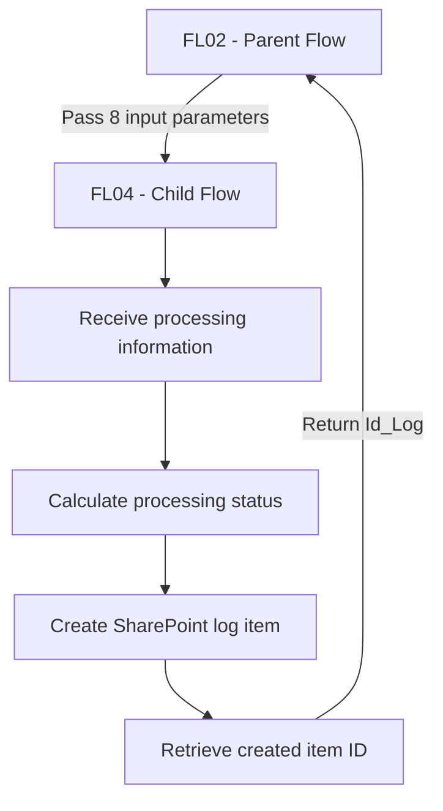

# FL04 - Processing Logs and Error Tracking

## Overview

FL04 is a reusable Power Automate child flow that records processing results and errors in a SharePoint Online list.

It is invoked by FL02, the parent Excel processing workflow, and returns the identifier of the newly created log entry.

This conceptual demonstration illustrates centralized logging, execution traceability, and reusable automation components.

## Architecture

## Trigger

**Manually trigger a flow**

FL04 is called by FL02 and receives eight input parameters.

## Input Parameters

| Parameter | Type | Description |
|---|---|---|
| ProcessingReferenceId | Number | Reference identifier for the processing operation |
| SourceFileId | Number | Identifier of the source file |
| SourceFileName | Text | Name of the processed Excel file |
| RecordsRead | Number | Number of records read |
| RecordsCreated | Number | Number of records created |
| RecordsWithErrors | Number | Number of records with errors |
| ErrorDetails | Text | Details of processing errors |
| ExecutionId | Text | Identifier used for execution traceability |

## Workflow Steps

1. Receive processing parameters from FL02.
2. Evaluate the processing results to determine the execution status.
3. Generate the execution timestamp using `utcNow()`.
4. Create a new item in the SharePoint processing log list.
5. Store processing counts, error details, and execution identifiers.
6. Retrieve the ID of the created SharePoint item.
7. Return `Id_Log` to the parent flow.

## Processing Status Logic

The workflow determines the processing status based on the number of successfully created records and records with errors.

| Records Created | Records With Errors | Status |
|---|---|---|
| Greater than 0 | 0 | Success |
| Greater than 0 | Greater than 0 | Partial Success |
| 0 | Greater than 0 | Error |
| 0 | 0 | No Records |

The No Records status distinguishes executions that produce no records and report no errors from failed executions.

This conceptual status model assumes that RecordsWithErrors accurately reflects the relevant processing failures.

The status logic must be validated against the actual parent flow outputs during implementation.

## SharePoint Log Structure

Example fictional SharePoint list: `Processing Logs List`

| Column | Purpose |
|---|---|
| ProcessingReferenceId | Processing reference |
| SourceFileId | Source file identifier |
| ExecutionDate | Execution timestamp |
| RecordsRead | Total records read |
| RecordsCreated | Successfully created records |
| RecordsWithErrors | Records with errors |
| Status | Calculated processing result |
| ErrorDetails | Error information |
| ExecutionId | Flow execution reference |

The source file name is received as an input parameter but is not included in the demonstrated SharePoint field mapping.

## Output

| Parameter | Type | Description |
|---|---|---|
| Id_Log | Number | ID of the newly created SharePoint log item |

The output allows FL02 to reference the log entry created by FL04.

## Technical Highlights

- Reusable parent-child flow architecture.
- Parameterized flow execution.
- Centralized SharePoint logging.
- Conditional status calculation.
- Automatic UTC execution timestamps.
- Execution traceability.
- Structured response to the parent workflow.

## Technologies

- Microsoft Power Automate
- SharePoint Online
- Power Automate child flows
- Workflow expressions
- JSON
- Mermaid

## Implementation Status

**Conceptual demonstration. Not an importable Power Automate flow.**

The `FL04-demo.json` file describes the workflow architecture and does not contain executable Power Automate action definitions.

## Security

- Fictional SharePoint site and list.
- No real processing records.
- No credentials or corporate identifiers.
- No proprietary solution exports.
