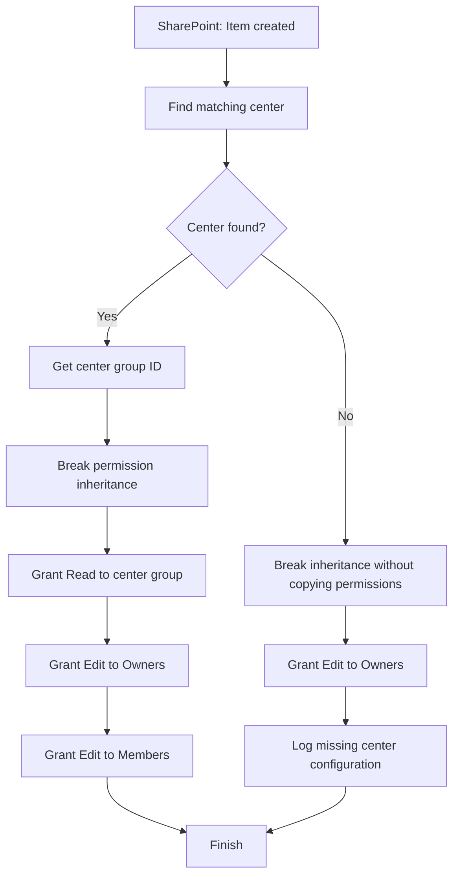

# FL05 - Dynamic SharePoint Permissions

## Overview

Conceptual demonstration of a Power Automate workflow that dynamically assigns item-level permissions in SharePoint Online.

The workflow uses a separate configuration list to identify the security group associated with each business record.

## Architecture

### Workflow Diagram

## Workflow Steps

1. Trigger when a new item is created in the Processed Records List.
2. Search the Centers Configuration List for the matching center.
3. Check whether a matching center configuration exists.

### Center Found

When a matching center is found:

1. Retrieve the configured SharePoint group identifier.
2. Break permission inheritance on the new item.
3. Grant Read permissions to the configured center group.
4. Grant Edit permissions to the Owners group.
5. Grant Edit permissions to the Members group.
6. Complete the permission assignment process.

### Center Not Found

When no matching center is found:

1. Break item permission inheritance without copying existing permissions.
2. Grant Edit permissions to the Owners group.
3. Do not grant permissions to any center group.
4. Log a configuration error indicating that the center was not found.
5. Complete the workflow with the missing-center condition documented.

### Security Considerations

The missing-center branch follows a restrictive access model to avoid exposing records to unrelated center groups.

In a production implementation, permission inheritance changes must be performed using an account with sufficient privileges.

The implementation must ensure that the flow execution identity and authorized administrators retain the access necessary to complete permission assignment.

Permission changes and error handling should be tested before deployment to prevent accidental loss of access.
s.

## Configuration-Driven Permissions

The workflow uses a SharePoint configuration list rather than hardcoded center-to-group mappings.

Example using fictional values:

| Center Reference | Security Group |
|---|---|
| REGION-A | Center-Group-A |
| REGION-B | Center-Group-B |
| REGION-C | Center-Group-C |

## Permission Matrix

| Group | Permission Level |
|---|---|
| Configured center group | Read |
| Owners | Edit |
| Members | Edit |

The configured center group receives Read access only to records assigned to its center. Owners and Members retain Edit permissions across all records. Other center groups must not have access to records outside their assigned center.

## Technical Highlights

- SharePoint event-driven automation.
- Configuration-driven security group selection.
- Conditional processing based on lookup results.
- Dynamic group identifier retrieval.
- SharePoint permission inheritance management.
- Item-level access control.
- SharePoint REST API integration.

## Technologies

- Microsoft Power Automate
- SharePoint Online
- SharePoint REST API
- SharePoint security groups
- JSON
- Mermaid

## Implementation Status

**Conceptual demonstration. Not an importable Power Automate flow.**

The FL05-demo.json file describes the workflow architecture and does not contain executable Power Automate action definitions.

## Security

- Fictional SharePoint sites and lists.
- Fictional center references and group names.
- No real user data.
- No credentials or corporate identifiers.
- No proprietary solution exports.
