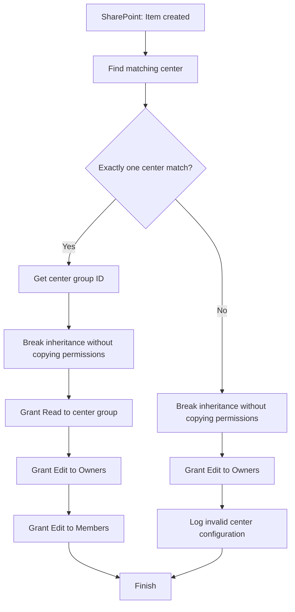

# FL05 - Dynamic SharePoint Permissions

## Overview

Conceptual demonstration of a Power Automate workflow that dynamically assigns item-level permissions in SharePoint Online.

The workflow uses a separate configuration list to identify the security group associated with each business record.

FL05 follows a restrictive security model when the center configuration is missing or duplicated, preventing unintended permission assignments.

## Architecture

### Workflow Diagram



The diagram illustrates the conceptual permission assignment process.

A valid center configuration requires exactly one matching record in the Centers Configuration List.

If the lookup returns zero or multiple matches, FL05 follows the restrictive branch.

## Workflow Steps

1. Trigger when a new item is created in the Processed Records List.
2. Search the Centers Configuration List for the matching center.
3. Check whether exactly one matching center configuration exists.
4. Apply the corresponding item-level permission strategy.

### Center Found

When exactly one matching center configuration is found:

1. Retrieve the configured SharePoint group identifier.
2. Break item-level permission inheritance without copying existing permissions.
3. Grant Read permissions to the configured center group.
4. Grant Edit permissions to the Owners group.
5. Grant Edit permissions to the Members group.
6. Complete the permission assignment process.

The conceptual JSON represents this behavior through the `ifTrue` branch of the `CenterFound` condition.

The permission inheritance action uses:

```json
"copyExistingPermissions": false
```

This prevents the automatic retention of inherited permissions when the item receives its unique permission configuration.

### Invalid Center Configuration

FL05 requires exactly one matching center configuration.

The conceptual condition is:

```text
length(matchingRecords) = 1
```

If no matching center is found, or multiple configurations match the same center, the workflow follows the restrictive branch.

The workflow:

1. Breaks item-level permission inheritance without copying existing permissions.
2. Grants Edit permissions to the Owners group.
3. Does not grant permissions to the Members group or any center group.
4. Logs a configuration error through `LogInvalidCenterMapping`.
5. Completes with the invalid center configuration documented.

The diagnostic message is:

```text
Center configuration validation failed. No unique matching center was found in Centers Configuration List (missing or duplicate configuration). Center permissions were not granted.
```

This prevents missing or ambiguous center mappings from granting access to an unintended SharePoint group.

The conceptual JSON does not yet explicitly validate whether the configured SharePoint Group ID is valid and usable. This must be verified during implementation.

### Security Considerations

The invalid-center-configuration branch follows a restrictive access model to avoid exposing records to unrelated center groups.

Both conditional branches interrupt item-level permission inheritance without copying existing permissions.

In a production implementation, permission inheritance changes must be performed using an account with sufficient privileges.

The implementation must ensure that the flow execution identity and authorized administrators retain the access necessary to complete permission assignment.

Permission changes and error handling should be tested before deployment to prevent accidental loss of access.

## Configuration-Driven Permissions

The workflow uses a SharePoint configuration list rather than hardcoded center-to-group mappings.

Example using fictional values:

| Center Reference | Security Group |
|---|---|
| REGION-A | Center-Group-A |
| REGION-B | Center-Group-B |
| REGION-C | Center-Group-C |

The configuration list allows authorized administrators to maintain center-to-group relationships without modifying the conceptual workflow for every mapping change.

Each operational center should have one valid configuration entry.

Duplicate or missing center mappings must be treated as configuration errors.

## Permission Matrix

The workflow applies different permissions depending on whether exactly one matching center configuration is found.

| Group | Valid Center Configuration | Invalid Center Configuration |
|---|---|---|
| Configured center group | Read | No access granted |
| Owners | Edit | Edit |
| Members | Edit | No access granted |
| Other center groups | No access granted | No access granted |

### Permission Rules

- Center groups receive Read access only to records assigned to their center.
- Owners receive Edit access in both scenarios.
- Members receive Edit access only when exactly one matching center configuration is found.
- No permissions are granted to unrelated center groups.
- Missing or duplicate center configurations are recorded as diagnostic errors.
- Permission inheritance is interrupted without copying existing permissions.
- Invalid center mappings must not result in unintended access.

### Implementation Considerations

This matrix describes the intended permissions of the conceptual workflow.

Effective permissions must be verified in SharePoint, including site collection administrators, the flow execution identity, and any access retained after breaking inheritance.

The implementation must not assume that breaking inheritance automatically removes every form of administrative access.

Additional implementation validation is required for:

- Invalid or nonexistent SharePoint Group IDs.
- Missing and duplicate center mappings.
- Users belonging to multiple SharePoint groups.
- Permission assignment failures.
- Access retained by site collection administrators.
- Automation connections with elevated privileges.
- Records created before FL05 completes its permission assignments.

The initial permissions of newly created records must prevent unintended access during the interval between item creation and FL05 permission assignment.

## Technical Highlights

- SharePoint event-driven automation.
- Configuration-driven security group selection.
- Unique center mapping validation.
- Restrictive handling of missing or duplicate center configurations.
- Dynamic group identifier retrieval.
- SharePoint permission inheritance management.
- Item-level access control.
- SharePoint REST API integration.
- Diagnostic logging for invalid configurations.

## Technologies

- Microsoft Power Automate
- SharePoint Online
- SharePoint REST API
- SharePoint security groups
- JSON
- Mermaid

## Implementation Status

**Conceptual demonstration. Not an importable Power Automate flow.**

The `FL05-demo.json` file describes the workflow architecture and does not contain executable Power Automate action definitions.

The conceptual design documents the intended permission assignment behavior.

Actual SharePoint permissions, group resolution, error handling, and automation execution require validation in a controlled environment.

## Security

- Fictional SharePoint sites and lists.
- Fictional center references and group names.
- No real user data.
- No credentials or corporate identifiers.
- No proprietary solution exports.
- Restrictive permission handling for missing or duplicate center configurations.
- Explicit validation requirements before production deployment.
