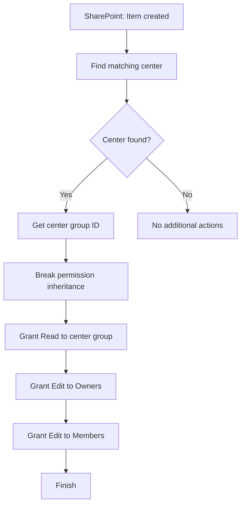

# FL05 - Dynamic SharePoint Permissions

## Overview

Conceptual demonstration of a Power Automate workflow that dynamically assigns item-level permissions in SharePoint Online.

The workflow uses a separate configuration list to identify the security group associated with each business record.

## Architecture

### Workflow Diagram

## Workflow Steps

1. Trigger when a new SharePoint list item is created.
2. Search a separate configuration list for the matching center.
3. Check whether the search returned at least one result.
4. Retrieve the configured center group identifier.
5. Break permission inheritance for the new item.
6. Grant Read permissions to the configured center group.
7. Grant Edit permissions to the Owners group.
8. Grant Edit permissions to the Members group.

If no matching center is found, the conditional branch performs no additional actions.

## Configuration-Driven Permissions

The workflow uses a SharePoint configuration list rather than hardcoded center-to-group mappings.

Example using fictional values:

| Center Reference | Security Group |
|---|---|
| REGION-A | Center-Group-A |
| REGION-B | Center-Group-B |
| REGION-C | Center-Group-C |

## Permission Matrix

| Group | Permission Level |
|---|---|
\| Configured center group \| Read \|
| Owners | Edit |
| Members | Edit |

The configured center group receives Read access only to records assigned to its center. Owners and Members retain Edit permissions across all records. Other center groups must not have access to records outside their assigned center.

## Technical Highlights

- SharePoint event-driven automation.
- Configuration-driven security group selection.
- Conditional processing based on lookup results.
- Dynamic group identifier retrieval.
- SharePoint permission inheritance management.
- Item-level access control.
- SharePoint REST API integration.

## Technologies

- Microsoft Power Automate
- SharePoint Online
- SharePoint REST API
- SharePoint security groups
- JSON
- Mermaid

## Implementation Status

**Conceptual demonstration. Not an importable Power Automate flow.**

The FL05-demo.json file describes the workflow architecture and does not contain executable Power Automate action definitions.

## Security

- Fictional SharePoint sites and lists.
- Fictional center references and group names.
- No real user data.
- No credentials or corporate identifiers.
- No proprietary solution exports.
